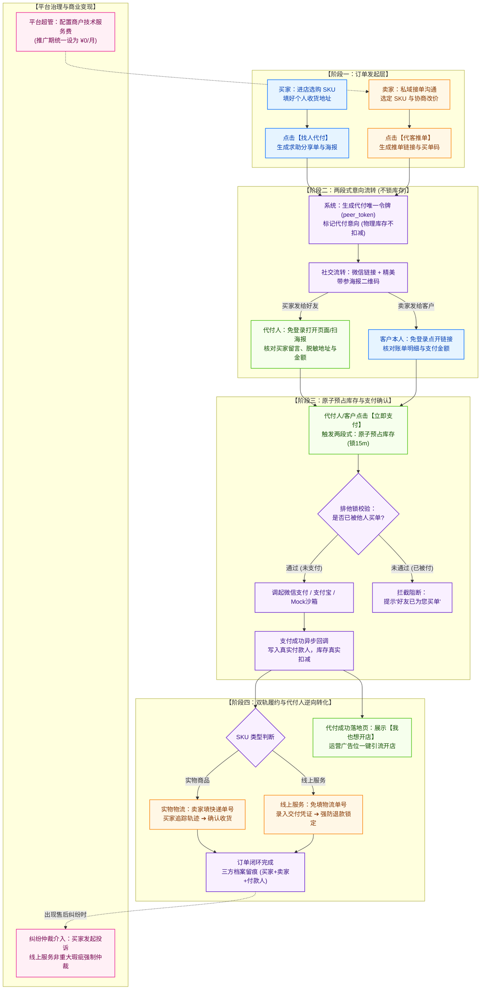
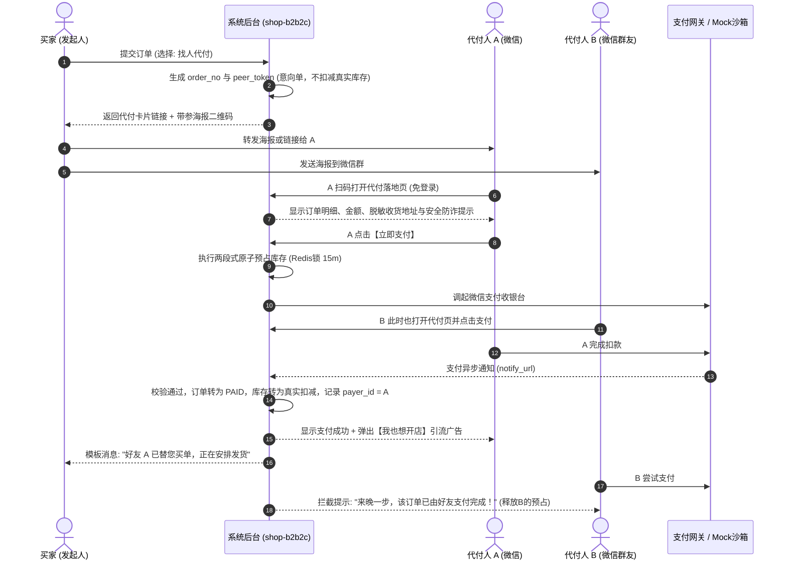

# B2B2C 电商平台 MVP 业务架构与“找人代付”核心引擎设计规范

> **文档状态**：已归档 / MVP 实施基线 (v1.3 核心战略决策深化版)  
> **工程基底**：基于现有的 `shop-b2b2c` 架构体系平滑扩展  
> **核心定位**：以“找人代付”为社交转化裂变引擎、以“商户技术服务费”为合规变现模式的 B2B2C 最小商业闭环

---

## 一、 产品定位与核心商业闭环

本产品原型（MVP）专注于打造一个高转化、极简履约的 B2B2C 社交与私域电商平台。核心差异化竞争力是以“找人代付”为销售转化的增长飞轮，以“商户技术服务费”为合规变现支柱，以“实物快递 + 线上服务”为双轨履约交付体系，以“平台全局账单与全息档案”为运营掌控中枢。

* **工程原则**：**坚决反对推倒重来**，直接在现有的 `shop-b2b2c` (Spring Boot / Java 多商户体系) 上进行轻量增量扩展，最大限度复用已有的店铺（MerchantStore）、商品（Product）与订单（Order）资产。

---

## 二、 三大角色 MVP 核心功能矩阵与职责清单

平台生态严格划分三大角色边界，实现闭环管理、高效开单、极速收银与维权仲裁：

```
┌────────────────────────────────────────────────────────────────────────┐
│                        平台超级管理端 (Super Admin)                       │
├────────────────────────────────────────────────────────────────────────┤
│ 1. 卖家与店铺审核：审核开店申请、注销店铺、冻结/解冻违规商铺             │
│ 2. 服务费配置：配置各卖家的每月服务费、免费期截止日、缴费豁免标记         │
│ 3. 全局 SKU 监管：全平台商品列表查看、违规 SKU 强制下架                  │
│ 4. 纠纷仲裁处理：查看买家对卖家的投诉工单、回复买家并跟踪整改进度         │
│ 5. 运营广告配置：后台配置代付成功页【我也想开店】广告位、引导转卖家       │
└────────────────────────────────────────────────────────────────────────┘
                                    │
                                    ▼
┌────────────────────────────────────────────────────────────────────────┐
│                           卖家端 (Merchant Console)                     │
├────────────────────────────────────────────────────────────────────────┤
│ 1. 店铺基本设置：店铺名称、Logo、联系电话/微信、店铺公告                  │
│ 2. SKU 进销存：新增/编辑/上架/下架商品，勾选【物流发货】或【线上服务】     │
│ 3. ★【代客推单】：选择 SKU 一键生成代付账单链接与精美海报推给客户付款   │
│ 4. 履约发货：实物订单填快递单号；线上服务填写交付凭证一键完成服务         │
│ 5. 维权响应：查看买家的投诉工单并在线答复协商，提请平台介入仲裁           │
└────────────────────────────────────────────────────────────────────────┘
                                    │
                                    ▼
┌────────────────────────────────────────────────────────────────────────┐
│                      买家 & 代付人端 (Storefront & H5)                  │
├────────────────────────────────────────────────────────────────────────┤
│ 1. 拼多多风格店铺前台：店铺头信息、商品图文瀑布流、SKU 规格选择          │
│ 2. 结算收银台：支持【自行支付】与【★ 找人代付】双通道                     │
│ 3. ★【求助代付分享卡片 & 海报】：生成微信卡片与精美带参代付海报二维码    │
│ 4. ★【极简代付页】：代付人免注册登录，展示订单详情，一键拉起微信/支付宝支付 │
│ 5. 订单与维权中心：查看物流单号或线上服务凭证，不满意可向平台提交投诉     │
│ 6. ★【代付人逆向转化】：代付成功展示【我也想开店】等平台运营广告与活动   │
└────────────────────────────────────────────────────────────────────────┘
```

### 1. 平台超级管理端 (Super Admin Console)

| 功能模块 | 核心功能点 | MVP 最小可用范围与交互说明 |
| :--- | :--- | :--- |
| **卖家与店铺审核** | 开店入驻审核 / 店铺状态管理 | 查看卖家提交的基础信息（店名、联系人、手机号、身份证信息）；执行【通过】、【驳回】、【冻结店铺】、【注销店铺】。违规商户冻结后其前台店铺与SKU立即隐藏。 |
| **商户服务费配置** | SaaS 软件技术服务费管控 | 配置各卖家的每月服务费金额（推广期统一设为 ¥0/月）；设置免费试用截止日期；标记特殊商户“免缴服务费”；逾期提醒与欠费只读限制。 |
| **全局 SKU 监管** | 全平台商品大盘与违规下架 | 跨商户检索所有上架与下架商品；支持按店铺、类目、关键词筛选；超管有权对涉嫌违规、侵权或违禁 SKU 执行【强制下架】，并下发整改通知。 |
| **纠纷仲裁处理** | 投诉工单流转与官方仲裁 | 集中受理买家针对卖家的投诉工单；查看订单详情、买卖双方沟通留痕与发货凭证；平台官方录入仲裁回复，督促卖家整改或判定退款。 |
| **★ 运营广告配置** | 代付人逆向裂变广告位管控 | 超管后台可灵活配置代付成功页面的引流横幅：包含广告标题、宣传海报图、跳转目标（如唤起【我也想开店】极简入驻表单）。 |

### 2. 卖家商户端 (Merchant Console)

| 功能模块 | 核心功能点 | MVP 最小可用范围与交互说明 |
| :--- | :--- | :--- |
| **店铺基本设置** | 品牌与联系方式配置 | 维护店铺全称、品牌 Logo、联系电话、客服微信二维码、店铺介绍与主页顶部公告栏。 |
| **SKU 进销存** | 商品发布与双轨交付属性 | 商品标题、主图与详情图、价格、库存；**核心开关：勾选【物流发货】（实物）或【线上服务】（虚拟免物流）**；线上服务需配置交付指引说明。 |
| **★【代客推单】** | 私域导购促成极速付款 (核心) | 卖家在私域与客户沟通后，直接在后台勾选商品 SKU、协商改后总价，**一键生成专属代付账单链接与精美海报二维码**推给客户打开即付，免除客户加购选规格阻碍。 |
| **双轨履约发货** | 实物与线上服务差异化履约 | **实物订单**：选择快递公司并录入快递单号发货；<br>**线上服务订单**：免填物流单号，录入交付凭证（卡密/网盘下载链接/交付报告/服务完成说明）一键标记履约完成。 |
| **维权响应** | 买家纠纷协商处置 | 实时接收买家提交的投诉工单，在线提交商家说明与举证凭证，与买家协商和解或提请平台超管介入裁决。 |

### 3. 买家 & 代付人端 (Buyer & Payer Storefront / H5)

| 功能模块 | 核心功能点 | MVP 最小可用范围与交互说明 |
| :--- | :--- | :--- |
| **拼多多风格店铺前台** | 沉浸式移动端店铺展示 | 移动端自适应店铺主页：店铺头部背景与信誉标、商品两列流式瀑布流展示、商品详情页、SKU 规格属性弹窗选择（颜色/尺寸/套餐）。 |
| **结算收银台双通道** | 自行支付 vs 找人代付 | 买家填妥个人收货地址后进入收银台，显式提供两大按钮：**【自行支付】**（常规微信/支付宝）与 **【★ 找人代付】**（触发社交买单）。 |
| **★【求助代付分享】** | 社交化买单分享与海报防封 | 买家选择找人代付后，系统生成代付订单并弹出分享浮层，买家可填入“请客留言”，**支持一键复制微信链接或生成精美带参代付海报图片**，彻底规避微信外链拦截。 |
| **★【极简代付页】** | 免登录 10 秒快速买单 (核心) | 代付人点击链接或扫码后，**零门槛免注册登录**，页面清晰展示买家留言、商品明细、代付金额与安全防诈提示，一键唤起微信支付或支付宝完成付款。 |
| **订单与维权中心** | 进度跟踪与平台维权 | 买家随时查看名下订单状态；追踪物流轨迹或查验线上服务交付凭证；商品有瑕疵或服务不到位时，**一键发起投诉工单直达商户与平台超管**。 |
| **★【代付人逆向转化】** | 代付人转为新商户/新客 | 代付成功后，页面展示后台配置的【我也想开店】广告位，点击一键唤起商户申请或领券逛店，实现低成本高效客源裂变。 |

---

## 三、 卖家代付 vs 买家代付：核心区别解析

在电商体系中，“代付”绝不仅仅是买家单向发起的求助，而是涵盖了**私域销售**与**社交裂变**的两种截然不同的杀手级场景：

| 维度对比 | 场景 A：买家求助代付 (Buyer Peer-Pay) | 场景 B：卖家代客做单 / 推单代付 (Seller Push-Pay) |
| :--- | :--- | :--- |
| **发起主体** | **买家（消费者）** | **卖家（商家 / 销售人员）** |
| **业务出发点** | 买家看中商品但无支付能力或寻求他人买单（情侣、家庭、人情） | 私域私聊、社群、展厅销售时，促成客户**极速付款**，缩短购买链路 |
| **收货地址由谁填** | **买家在发起求助前填写好自己的收货地址**，代付人只出钱不可篡改 | 卖家推单时可预先填好，或买家在打开支付链接时一键选填 |
| **付款人是谁** | **第三人（亲友、伴侣、父母）**，付款人无需收货 | **买家客户本人**，客户仅需确认金额并支付 |
| **核心解决的痛点** | 解决买家端“想买但钱包没钱”的支付转化卡点 | 解决客户“嫌加购、选规格、注册繁琐而流失”的私域导购痛点 |
| **现代电商对标** | 淘宝“找人代付”、拼多多“好友代付”、美团代付 | 美团外卖“商家推单收款”、有赞“代客做单”、大宗电商销售开单 |

---

## 四、 端到端代付业务流程图 (Mermaid)

### 1. 业务全景流转图 (Flowchart)



---

### 2. 两段式预占与并发防刷时序图 (Sequence Diagram)



---

## 五、 五大核心战略决策的落地规范

### 1. 资金流与支付方案的三阶段平滑演进路线

针对电商合规门槛（ICP 增值电信业务许可证、EDI 在线数据处理与交易处理许可证、财务“二清”监管），平台制定清晰明确的**三阶段演进策略**：

```
【阶段 0：工程研发与链路验证】
方案 C (Mock 沙箱测试桩)
  * 本地/测试环境开启 payment.mock=true
  * 零门槛跑通令牌防重、并发排他锁、超时释放、退款流水等全部状态机

         │
         ▼ 商业启动 (MVP 阶段一)

【阶段 1：MVP 正式商业运行期】
方案 B (商户独立去中心化直收)
  * 卖家在后台绑定自主收款凭证 (微信/支付宝收款商户号/二维码)
  * 代客推单与代付直接唤起商家直接收款，平台完全不碰触、不沉淀买卖交易资金
  * 彻底免除 EDI 牌照审批前置障碍与二清合规法律风险，技术服务费通过线下或独立订阅通道缴纳

         │
         ▼ 平台规模化成熟 (终极形态)

【阶段 2：合规成熟与生态级分账】
方案 A (平台统一企业大商户 / 微信电商收付通)
  * 取得增值电信业务 EDI / ICP 许可证
  * 统一接入微信“电商收付通”与支付宝“直付通”，由银行和微信官方对二级商户进行自动分账
```

---

### 2. 线上服务不可逆履约铁律与“买-卖-付”三方全息交易档案

* **不可逆履约保护**：
  * 针对【线上服务】SKU，卖家在后台录入交付凭证（卡密、网盘资源链接、交付报告）后，系统立即锁定订单状态为 `FULFILLED`。
  * 买家端前台弹出强提醒：**“线上服务一经交付凭证，非重大质量问题不可无理由极速退款，退款须经平台超管官方仲裁”**。
  * 平台超管拥有唯一仲裁驳回或强制退款权限，彻底杜绝买家白嫖虚拟资产后恶意退款的漏洞。
* **“买-卖-付”三方不可篡改画像档案**：
  * 每笔电商交易在底层必须强行关联三方实体 ID：
    $$\text{交易实体} = \langle \text{卖家 ID (Seller)}, \text{买家 ID (Buyer)}, \text{实际付款人 ID (Payer)} \rangle$$
  * 平台全域账单与风控系统对三方实体进行全生命周期留痕，任何一环出现洗钱套现、恶意退款或欺诈行为，均可秒级逆向穿透追溯。

---

### 3. 两段式库存预扣锁状态机 (Two-stage Inventory Reservation)

为了解决恶意刷单锁死库存与代付人付款超卖的矛盾，系统实施**两段式库存控制**：

1. **第一段：代付/推单意向阶段 (No Lock)**：
   * 买家提交找人代付，或卖家后台代客推单时，仅生成 `peer_token` 记录意向单，**物理库存与可售库存均不锁定**；
2. **第二段：代付人调起收银台阶段 (Atomic 15m Lock)**：
   * 代付人打开页面并点击【立即支付】时，系统执行 Redis 原子递减 `decrWithExpire` 预占库存（锁定 15 分钟）；
3. **结算闭环**：
   * **付款成功**：数据库真实扣减物理库存，释放 Redis 预占锁；
   * **超时未付 / 主动放弃**：15 分钟后 Redis 预占自动失效回补，或代付人关闭收银台时主动释放。

---

### 4. 微信防封与双轨社交裂变传播引擎 (Anti-Blocking Poster Engine)

微信对“代付/众筹”类外部文本链接风控极为严苛。系统构建**双轨传播承接体系**：

* **微信好友卡片**：在微信官方开放平台报备的白名单域名内，支持标准微信卡片分享；
* **★ 精美商品代付海报二维码 (核心防封武器)**：
  * 系统在买家发起代付或卖家代客推单时，前端利用 Canvas / 后端图形服务**一键生成一张 9:16 精美海报图片**；
  * 海报包含：店铺品牌 Logo、商品高清首图、SKU 规格说明、协商代付金额、买家留言（如“江湖救急，帮我买个单呗~”）、带有效期的加密代付专属二维码；
  * 用户可长按保存图片直接发到微信群或朋友圈。图片分享不触发微信网页外链拦截红封，经业界验证**视觉转化率提升 3 倍以上**。

---

### 5. 代付人逆向流量捕获与后台可配广告位

能替他人代付的用户是极具消费能力与社交信任度的高净值客群。系统将代付成功页打造为**裂变流量漏斗**：

* **【我也想开店】商户招募广告位**：
  * 代付人在支付成功完成页，正下方展示醒目运营广告 Banner：“**0 元免照开店，像 TA 一样私域推单极速收款**”；
  * 点击直接呼出极简开店入驻申请表单（仅需手机号与店铺名即可秒级预开店）。
* **超管后台全局动态配置**：
  * 超管可在后台随时启停该广告位、上传自定义宣传海报、更换标语与跳转链接（如切换为平台新人特惠商品专区或商户招募页）。

---

## 六、 基于现有 `shop-b2b2c` 架构的模型扩展

直接复用 `shop-b2b2c` (Spring Boot 3 + JPA) 现有资产，平滑扩充字段与表：

```
【现有 shop-b2b2c 实体】                      【增量扩展字段】
MerchantStore (店铺表)    ───────────> monthly_fee (月度技术服务费，默认0)
                                      fee_free_until (免费期截止时间)
                                      fee_status (NORMAL/TRIAL/OVERDUE)
                                      payment_channel_type (B:商户独立直收, C:Mock沙箱)
                                      custom_pay_qrcode (商户自主收款码/凭证URL)

Product (商品表)          ───────────> is_virtual (0: 物流实物, 1: 线上服务)
                                      service_desc (线上交付说明与防退款警示)

Order (订单表)            ───────────> order_channel (1: 买家自主下单, 2: 卖家推单代客)
                                      peer_pay_token (代付防撞唯一短码，如: PP_8a9f2e)
                                      peer_pay_type (0: 自付, 1: 买家代付, 2: 卖家推单)
                                      peer_payer_id (实际代付人的openid或唯一凭证)
                                      peer_status (INIT/RESERVED_LOCK/PAID/EXPIRED)
                                      service_voucher (线上交付凭证/网盘/卡密信息)
                                      poster_url (生成的代付海报图片静态访问地址)

新增表: BillingStatement ───────────> 存放商户日/月对账汇总数据
新增表: Complaint        ───────────> 存放买家发起的投诉建议与超管仲裁记录
新增表: PlatformAdConfig ───────────> 存放代付成功页【我也想开店】广告位配置
```

---

## 七、 核心增量 REST API 接口清单

| 模块 | 接口路径 | 方法 | 功能说明 |
| :--- | :--- | :---: | :--- |
| **卖家代客推单** | `/api/v1/merchant/order/push-pay` | `POST` | 卖家选定 SKU 与改后价，生成推单代付链接与海报 |
| **买家求助代付** | `/api/v1/order/{id}/peer-pay/request` | `POST` | 买家下单生成求助代付意向单，生成分享链接与海报 |
| **代付落地收银** | `/api/v1/peer-pay/detail/{token}` | `GET` | **免登录**拉取代付商品简报、买家留言与脱敏地址 |
| **立即支付预占** | `/api/v1/peer-pay/pre-lock/{token}` | `POST` | 代付人点击立即支付，原子预占库存并调起收银台 |
| **支付结果回调** | `/api/v1/peer-pay/notify/{token}` | `POST` | 支付成功回调（Mock沙箱或微信通知），转真实扣减 |
| **虚拟履约发货** | `/api/v1/merchant/order/{id}/fulfill-virtual` | `POST` | 卖家录入交付凭证完成履约，触发防恶意退款强锁 |
| **代付成功广告** | `/api/v1/peer-pay/success-ad` | `GET` | 代付落地页获取超管配置的【我也想开店】宣传广告 |
| **超管广告配置** | `/api/v1/admin/operation/ad-config` | `PUT` | 平台超管配置代付成功页引流广告横幅与跳转目标 |
| **超管财务对账** | `/api/v1/admin/billing/statements` | `GET` | 平台超管拉取全平台商户日/月对账账单与GMV大盘 |
| **买家投诉仲裁** | `/api/v1/customer/complaint` | `POST` | 买家提交纠纷投诉工单，平台超管官方介入裁决 |

---

## 八、 MVP 开发实施路线图 (Phase 1)

1. **第 1 步：数据实体迁移 (Day 1)**
   * 在现有 `shop-b2b2c` 库中执行 SQL 脚本，在 `MerchantStore`、`Product`、`Order` 补齐字段，新建 `BillingStatement`、`Complaint` 与 `PlatformAdConfig` 表。
2. **第 2 步：代付两段式引擎与状态机开发 (Day 2)**
   * 实现卖家推单与买家求助代付意向 API，接入两段式 Redis 预占锁与 Mock 支付沙箱。
3. **第 3 步：免登移动端 H5 收银台与海报生成 (Day 3)**
   * 编写免登录代付落地页：脱敏地址、留言展示、安全反诈提示；前端集成 Canvas 海报生成。
4. **第 4 步：交付双轨、维权仲裁与广告位配置 (Day 4)**
   * 卖家后台增加虚拟履约与凭证录入；管理后台增加日/月对账单、买家投诉仲裁与代付成功页广告位配置。
5. **第 5 步：端到端闭环验证与压力测试 (Day 5)**
   * 模拟双人并发代付排他测试、超时失效释放库存测试、虚实商品履约与广告引流全流程验证。
