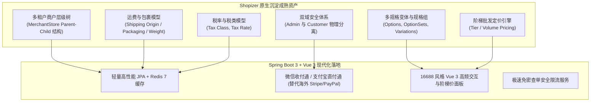
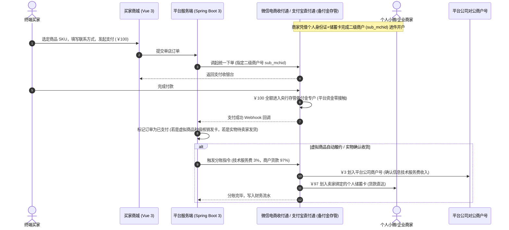

<!--
文件：00-项目介绍.md
用途：项目初始电商定位及对标业务背景说明。
维护注意：此处描述包含规划或历史验收记录，不代表当前代码已全部实现；现状以问题台账及最新Sprint记录为准，旧截图/链接不能替代可重复测试。
-->
# 00 - 通用 B2B2C 多商户全品类电商交易平台项目设计规范

> **项目名称**：Shop-B2B2C 现代通用多商户电商平台  
> **商业定位**：**通用全品类 B2B2C 聚合电商平台**（全面覆盖 3C 数码、服饰百货、美妆个护、食品生鲜、工业批发，并**原生兼容虚拟卡密/数字权益秒发**）  
> **核心策略**：
> 1. **架构与业务能力深度吸收 Shopizer**（成熟多租户隔离、变体规格矩阵、阶梯批发价、运费税费引擎、完整订单状态机、双域安全体系）；
> 2. **UI/UX 深度复刻 16688**（依托 `web-clone` 方法论，高还原度克隆 16688 的多级分类导航、金刚区、阶梯批发价矩阵、紧凑商品流、商户名片卡及免登录极速查单）；
> 3. **合规资金闭环**（依托《电商法》第十条支持小微个人免照开店，微信收付通/支付宝直付通二级分账，平台资金零接触、零二清、零虚高税负）。  
> **技术栈**：**Spring Boot 3.2.5 (JDK 17) + Vue 3 (Vite + Pinia + Element Plus + Tailwind CSS) + MySQL 8.0 + Redis 7**  
> **版本**：v2.0 (全品类综合重构版)  

---

## 目录
1. [项目定位纠正与全品类商业蓝图](#一项目定位纠正与全品类商业蓝图)
2. [深度吸收 Shopizer 核心业务模型与成熟架构](#二深度吸收-shopizer-核心业务模型与成熟架构)
3. [深度克隆 16688 的 UI/UX 设计规范 (结合 web-clone Skill)](#三深度克隆-16688-的-uiux-设计规范-结合-web-clone-skill)
4. [合规资金流与二级分账设计（彻底规避二清与虚高税负）](#四合规资金流与二级分账设计彻底规避二清与虚高税负)
5. [系统核心数据模型 (全面吸收 Shopizer 实体模型)](#五系统核心数据模型-全面吸收-shopizer-实体模型)
6. [B2B2C 角色体系与双重视角架构](#六b2b2c-角色体系与双重视角架构)
7. [三大工程模块职责与核心代码映射](#七三大工程模块职责与核心代码映射)
8. [环境要求与一键启动指南](#八环境要求与一键启动指南)

---

## 一、项目定位纠正与全品类商业蓝图

### 1.1 明确通用电商平台定位
本项目**并非单一的“卡密发卡网”**，而是定位于**通用的现代 B2B2C 多商户全品类电商交易平台**：
* **全品类商品覆盖**：全面支持实物批发与零售（服装鞋帽、数码家电、日用百货、办公用品、美妆日化、母婴玩具等）；
* **原生兼容虚拟数字权益**：无缝支持优惠券、兑换券、游戏点卡、软件授权码、会员激活码的**秒级自动核销与发放**；
* **拒绝狭隘标签**：平台视觉风格、信息排布、类目规划与品牌调性均遵循正规中大型通用电商标准，既具备工业级实物电商的运费模板、阶梯批发价与多规格变体，又拥有数字化产品的瞬时发货与免密极速查验能力。

---

## 二、深度吸收 Shopizer 核心业务模型与成熟架构

Shopizer 是全球知名的企业级开源电商系统，在底层设计上拥有数十项历经实战检验的核心资产。本项目在重构中深度吸纳其精髓：



### 核心吸纳要点：
1. **多商户组织架构 (`MerchantStore`)**：
   * 采用 `MerchantStore` 的父子店铺层级思想（Parent-Child 结构），既能支持平台总店自营，又能支持入驻商家独立核算，更利于未来扩展“一件代发”分销关系；
   * 后台用户（`sys_user`）和买家数据严格以 `merchant_id` 做物理隔离。
2. **企业级商品类目与多规格变体 (Catalogue & Variations)**：
   * 平台统一管控标准商品分类树（防止商户私自创建混乱顶层类目）；
   * 吸收 Shopizer 的多规格变体（颜色、尺码、批次、包装规格）与独立 SKU 编码体系；
   * 吸收阶梯批量批发定价机制（如：1~9 件单价 ￥30，10~49 件单价 ￥26，≥50 件单价 ￥22）。
3. **多模式运费计价与物流发货 (Shipping Modules)**：
   * 支持多物流快递商配置（顺丰、中通、圆通、韵达等）；
   * 支持发货地址（Origin Address）、包裹物理规格与重量定义；
   * 支持全国包邮规则或阶梯运费。
4. **订单全生命周期状态机与不可逆快照**：
   * 待支付 (`UNPAID`) -> 已付款/待发货 (`PAID`) -> 已发货/运输中 (`SHIPPED`) -> 已完成 (`COMPLETED`) -> 已取消/已退款 (`CLOSED`/`REFUNDED`)；
   * 下单瞬间沉淀商品标题、规格、单价的历史快照，防止商家后期改价影响历史账目。

---

## 三、深度克隆 16688 的 UI/UX 设计规范 (结合 web-clone Skill)

依据已成功加载的 **`web-clone` Skill** 方法论，我们对 16688 平台的视觉设计 DNA（Design DNA）进行了像素级解构，并在 **`shop-storefront-vue`** 中全量还原：

### 3.1 视觉系统规范 (Design System Tokens)
* **主色调 (Brand Color)**：活力橙 `#FF6600` / `#F97316`（象征批发活力与高转化），辅以专业沉稳深蓝 `#0F172A`。
* **背景层次 (Surface Hierarchy)**：
  * 主背景：柔和灰白 `#F8FAFC`；
  * 卡片背景：纯白 `#FFFFFF`，采用微边框 `border border-slate-200/80` 与轻阴影 `shadow-sm`；
  * 高亮背景：品牌浅橙 `#FFF7ED`。
* **字体层级 (Typography Scale)**：
  * 价格：特粗黑体 `font-black text-2xl tracking-tight text-orange-600`，辅以小号人民币符号；
  * 标题：紧凑双行截断 `text-sm font-bold text-slate-900 line-clamp-2`；
  * 标签 Badge：圆角微标签 `text-[11px] font-bold px-2 py-0.5`。

### 3.2 交互与布局规范 (Layout & Interaction DNA)
1. **全品类门户导航 Header**：
   * 顶部综合服务栏（买家查单、商户工作台登录、入驻申请）；
   * 大气品牌 LOGO + 巨型全局搜索框（带热门品类关键词胶囊标签）；
   * 主导航条（全品类货源大厅、今日爆款、工厂直发、数字权益专区、现货批发）。
2. **首页黄金三角结构**：
   * **左侧**：全品类多级悬浮类目导航（数码家电、服装箱包、日用百货、食品生鲜、虚拟权益）；
   * **中间**：品牌轮播大 Banner + 重点促销活动位；
   * **右侧**：商户入驻快捷卡片 + 平台服务保障说明 + 快捷查单工具箱。
3. **商品卡片流 (Compact Card Stream)**：
   * 现货/秒发 Badge（`⚡ 自动秒发` 或 `📦 现货包邮`）；
   * 阶梯起批量与起步价标注；
   * 店铺名称带认证徽标，直连【进店逛逛】与【立即选购】。
4. **详情页与阶梯采购收银台**：
   * 变体规格矩阵选择器（选颜色、尺码、批次）；
   * 阶梯批发价实时联动（买得越多单价越低）；
   * 极速下单收银台（无需繁琐跳转多级页面，直接在当前页面完成单店结算）。
5. **16688 标志性免登录快速查单 (Quick Query)**：
   * 凭**订单号 + 联系手机号/邮箱**秒级提取卡密或追踪顺丰/圆通快递轨迹，支持一键批量复制。

---

## 四、合规资金流与二级分账设计（彻底规避二清与虚高税负）

为保障平台企业长治久安，资金链路严格依托持牌支付机构进行二级分账：



* **彻底杜绝“二清”**：平台完全不触碰、不滞留商家货款，所有资金在微信/支付宝专户清算；
* **税务合规清晰**：平台仅就收取的 3% 佣金开具发票并纳税，不承担 100% 交易额的虚假营收税务风险。

---

## 五、系统核心数据模型 (全面吸收 Shopizer 实体模型)

数据库采用 **MySQL 8.0+**，字符集统一为 `utf8mb4`，包含 9 张高标准规范表：

1. `merchant_store`：商户店铺主表（支持个人小微、个体工商户、企业，带父子关系与抽佣费率）。
2. `merchant_payment_account`：微信/支付宝官方二级商户进件绑定表（记录 `sub_mchid` 与结算银行卡）。
3. `sys_user`：后台管理用户表（平台超管与商家员工，以 `merchant_id` 做严格物理数据隔离）。
4. `category`：统一标准商品类目树（支持无限层级挂靠）。
5. `product`：商品主表（包含实物商品 `goodsType=1` 与虚拟数字商品 `goodsType=2`）。
6. `product_sku`：多规格变体 SKU 表（存储规格 JSON、独立售价、物理库存）。
7. `product_virtual_card`：虚拟商品卡密库存库（支持批量导入与订单自动核销）。
8. `trade_order`：交易订单主表（单店独立结算、平台抽成、商户应结金额、二级分账状态、免密查单安全凭证）。
9. `trade_order_item`：订单明细表（记录下单时商品快照、规格信息、卡密文本快照）。

---

## 六、B2B2C 角色体系与双重视角架构

管理中台 (`shop-admin-vue`) 构建了**双重视角架构**：

| 角色代码 | 角色名称 | 默认视角 | 权能范围 |
| :--- | :--- | :--- | :--- |
| **`SUPERADMIN`** | **平台超级管理员** | 平台全局治理视角 | **支持一键在【平台视角】与【商家视角】自由切换**。总揽全平台交易 GMV、审批新商家入驻进件、调整店铺抽成费率、维护标准类目树、全平台订单分账监管。 |
| **`MERCHANT_ADMIN`** | **商家店长** | 商家工作台视角 | **严格锁定在商家视角**。维护本店资料与个人结算卡、发布多规格商品、批量导入卡密、实物录单发货、管理本店员工。 |
| **`MERCHANT_STAFF`** | **商家员工** | 商家工作台视角 | **严格锁定在商家视角**。根据权限处理打单发货或商品维护。 |
| **`BUYER`** | **终端消费者** | 买家商城前台 | 免登录浏览全品类货源、单店极速下单付款、免登录快速查单提取卡密或追踪物流。 |

---

## 七、三大工程模块职责与核心代码映射

所有重构源码均置于 **`E:\shop-b2b2c`**：

```
E:\shop-b2b2c\
├── init_db.sql                  # MySQL 8.0 数据库初始化与初始全品类种子数据
├── start_all.bat                # 一键全量启动脚本 (双击拉起全套服务)
├── README.md                    # 快速指南与账号文档
│
├── shop-b2b2c-backend/          # 【后端服务】Spring Boot 3.2.5 + JDK 17 (端口: 8082)
│   ├── src/main/java/com/shop/b2b2c/
│   │   ├── config/              # Security, JWT, Redis 限流, CORS
│   │   ├── entity/              # JPA 实体 (全面吸收 Shopizer 领域模型)
│   │   ├── repository/          # Spring Data JPA 仓储接口
│   │   └── controller/          # 认证、商户治理、商品SKU、订单发卡、免密查单
│   └── src/main/resources/application.yml
│
├── shop-admin-vue/              # 【管理中台】Vue 3 + Element Plus (端口: 3001)
│   └── src/views/
│       ├── layout/AdminLayout.vue # 平台超管 ⇋ 商家工作台双重视角切换
│       ├── admin/               # 平台交易大盘、商户准入审批、统一类目、订单监察
│       └── merchant/            # 商家经营看板、店铺结算资料、商品变体、卡密库、发货履约
│
└── shop-storefront-vue/         # 【买家商城】Vue 3 + Tailwind CSS (端口: 3002)
    └── src/views/
        ├── Home.vue             # 16688 风格全品类商品大厅 (分类导航、金刚区、紧凑卡片流)
        ├── Store.vue            # 商家独立店铺主页 (公告、全品陈列)
        ├── ProductDetail.vue    # 多变体规格矩阵选择器与单店极速收银台
        └── QuickQuery.vue       # 16688 招牌功能：免登录凭订单号+手机号 3 秒极速查单
```

---

## 八、环境要求与一键启动指南

### 8.1 运行依赖
* **JDK 17 LTS** (已就绪)
* **Node.js v22+ / NPM 10+** (已就绪)
* **MySQL 8.0+** (端口 3306，数据库 `shop_b2b2c`)
* **Redis 7** (端口 6379)
* **Web-Clone Skill** (已安装就绪于 `C:\Users\Administrator\.gemini\config\skills\web-clone`)

### 8.2 一键启动
直接双击运行：
👉 **`E:\shop-b2b2c\start_all.bat`**

* 管理中台（双重视角）：[http://localhost:3001](http://localhost:3001)
  * 超管账号：`superadmin` / `admin123`
  * 商家账号：`seller01` / `admin123`
* 买家端商城（16688 风格）：[http://localhost:3002](http://localhost:3002)
* 后端 OpenAPI 文档：[http://localhost:8082/swagger-ui.html](http://localhost:8082/swagger-ui.html)
