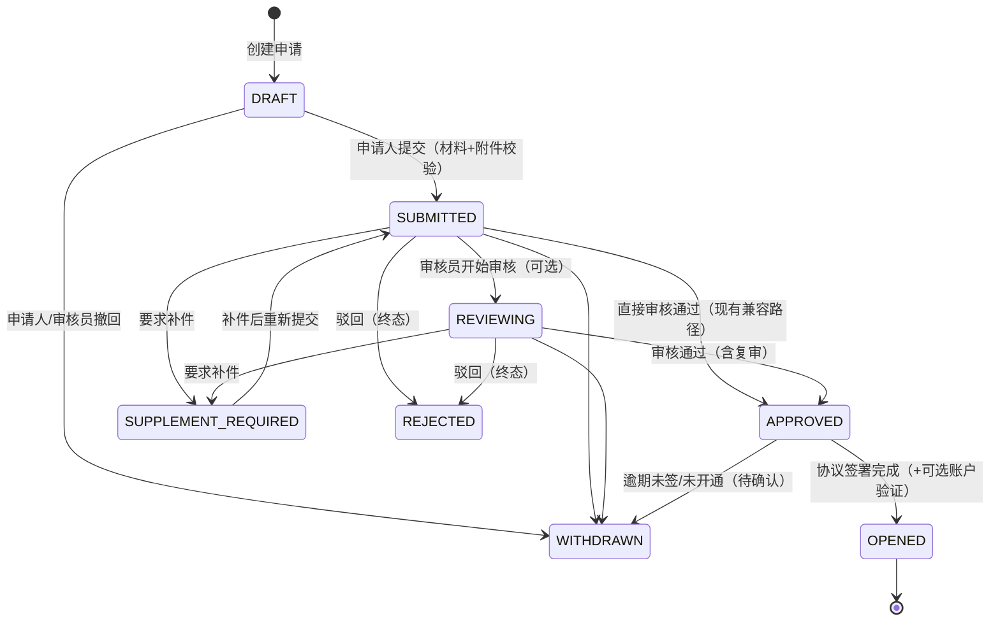

<!--
文件说明：本文件是 B2B2C 商城"商家开店/入驻"业务的开发指导文档，面向后续编码人员，覆盖业务边界、角色权限、状态机、资质与实名、结算账户验证、费率、协议合规、数据模型、接口契约、并发一致性、通知运营、测试矩阵、开发拆分与待决事项。
维护注意：
1. 本文以 2026-11-07 工作区代码为基线，逐项标注【现状】【改造】【待确认】【行业对标】。未落地内容不得在接口、页面或验收记录中表述为已实现。
2. 本文只给设计与 DDL 建议，不直接修改 schema.sql、不修改业务代码；数据库唯一运行时入口仍是 shop-b2b2c-backend/src/main/resources/db/schema.sql，结构变更须同步该文件，保留数据的开发库另写幂等迁移脚本。
3. 状态名、动作名、错误码保持英文；中文只用于展示与业务解释。新增状态/动作/原因码必须先更新本文附录 A 再改代码。
4. 涉及证件号、人脸视频、银行卡号的内容一律不得写入日志、示例、测试夹具真实值；接口只返回脱敏值。
5. 涉及资金、费率、账户的操作必须同时满足 docs/2026-11-06-financial-baseline.md 的硬性基线；审核角色、默认费率、价税分离税率、保证金等未决项见第 14 节，不得自行补业务值。
-->

# 商家开店流程开发文档（Merchant Onboarding Development Spec）

- 版本：v1.0（2026-11-07）
- 适用工程：`shop-b2b2c-backend`、`shop-admin-vue`、`shop-storefront-vue`、`deploy/`
- 输入依据：[开店流程初稿](file:///e:/shop-b2b2c/docs/开店流程初稿.md)、[商家结算设计与数据模型](file:///e:/shop-b2b2c/docs/2026-11-06-merchant-settlement-design.md)、[决策问卷（已确认归档）](file:///e:/shop-b2b2c/docs/2026-11-06-decision-questionnaire.md)、[开发过程缺口记录](file:///e:/shop-b2b2c/docs/2026-11-06-dev-gap-log.md)、[财务硬性基线](file:///e:/shop-b2b2c/docs/2026-11-06-financial-baseline.md)、[修复清单](file:///e:/shop-b2b2c/docs/2026-11-06-remediation-plan.md)
- 基线代码：[MerchantOnboardingService.java](file:///e:/shop-b2b2c/shop-b2b2c-backend/src/main/java/com/shop/b2b2c/service/MerchantOnboardingService.java)、[MerchantOnboardingController.java](file:///e:/shop-b2b2c/shop-b2b2c-backend/src/main/java/com/shop/b2b2c/controller/MerchantOnboardingController.java)、[PublicOnboardingController.java](file:///e:/shop-b2b2c/shop-b2b2c-backend/src/main/java/com/shop/b2b2c/controller/PublicOnboardingController.java)、[OnboardingAttachmentService.java](file:///e:/shop-b2b2c/shop-b2b2c-backend/src/main/java/com/shop/b2b2c/service/OnboardingAttachmentService.java)、[MerchantSettlementAccountService.java](file:///e:/shop-b2b2c/shop-b2b2c-backend/src/main/java/com/shop/b2b2c/service/MerchantSettlementAccountService.java)、[MerchantFeePolicyService.java](file:///e:/shop-b2b2c/shop-b2b2c-backend/src/main/java/com/shop/b2b2c/service/MerchantFeePolicyService.java)、[FinanceApprovalGuard.java](file:///e:/shop-b2b2c/shop-b2b2c-backend/src/main/java/com/shop/b2b2c/service/FinanceApprovalGuard.java)

---

## 0. 结论摘要（先看这一页）

1. **现有流程不是要推翻的"临时方案"，而是本项目的正式骨架**：公开申请 → 材料/证件上传 → 提交 → 超管人工审核（通过/驳回/补件/撤回）→ 自动建店、生成店长账号与初始费率。状态码 `DRAFT/SUBMITTED/REVIEWING/APPROVED/REJECTED/SUPPLEMENT_REQUIRED/WITHDRAWN` 已落库、有行锁、有审计、有测试。
2. **要补的不是"另一套流程"，而是行业标准里缺失的三段**：① 审核通过后先签协议再开通（当前审核通过即营业）；② 收款账户核验从"人工看一眼"升级为可选的打款验证；③ 店铺冻结/解封/关店/注销的审计与资金处置。三段都在现有状态机之上扩展，不重命名现有状态、不重写现有接口。
3. **初稿中的机审（OCR、公安实名、活体人脸）与本项目已确认决策 Q11/Q12 冲突**：阶段一明确为平台人工审核、人工核验账户，不接第三方实名。本文保留 `verification_method` 字段和扩展位，但不实现第三方调用。
4. **必须优先修掉的两个现状缺口**（否则生产环境开不了店）：
   - 管理端 [Onboarding.vue](file:///e:/shop-b2b2c/shop-admin-vue/src/views/admin/Onboarding.vue) 审核弹窗没有复核人下拉，且费率输入上限写成 `10000`、没有推广原因输入；生产双人复核开启时，后端会按"缺复核人=操作人"返回 428/403，0% 推广费率也无法从前端提交。
   - 同一实名主体并发创建申请只靠应用层 `COUNT` 预检，没有数据库唯一索引兜底，存在同时开出两张进行中申请的窗口。
5. **阶段一合规底线**：平台不代收货款、不形成资金池、不做二清；收款账户户名必须等于实名主体；证件/银行卡只存密文与指纹、接口只返回脱敏值；所有审核动作 append-only 留痕。

---

## 1. 业务范围与阶段划分

### 1.1 阶段一：商家直收 + 平台技术服务费（本期实现范围）

| 项目 | 阶段一规则 | 代码/文档依据 |
| --- | --- | --- |
| 收款方式 | 商家使用自有微信/支付宝/银行卡收款，平台不代收货款 | 决策 Q09；`MERCHANT_DIRECT` 流程 |
| 平台收入 | 技术服务费 1%~10%，0% 仅限推广期且必须写原因 | [MerchantFeePolicyService.java](file:///e:/shop-b2b2c/shop-b2b2c-backend/src/main/java/com/shop/b2b2c/service/MerchantFeePolicyService.java#L84-L119) |
| 费率来源 | 唯一来源 `merchant_fee_policy.getEffectivePolicy`；`merchant_store.commission_rate` 只是展示镜像 | T39；[MerchantFeePolicyService.java](file:///e:/shop-b2b2c/shop-b2b2c-backend/src/main/java/com/shop/b2b2c/service/MerchantFeePolicyService.java#L70-L77) |
| 费率生效 | 降费即时；调高次日 00:00；订单级快照，不回溯已下单订单 | 决策 S07；`adjust()` |
| 商家账号 | 审核通过自动生成 `MERCHANT_ADMIN`，用户名为申请手机号，初始密码一次性展示 | [MerchantOnboardingService.java](file:///e:/shop-b2b2c/shop-b2b2c-backend/src/main/java/com/shop/b2b2c/service/MerchantOnboardingService.java#L286-L324) |
| 商家员工 | `MERCHANT_STAFF` 只读展示资料、只处理被指派订单；不得看证件/银行卡/费率明文 | Q13-A；[AuthSessionService.java](file:///e:/shop-b2b2c/shop-b2b2c-backend/src/main/java/com/shop/b2b2c/service/AuthSessionService.java#L20-L35) |
| 开店审核 | 平台人工审核；审核角色暂为 `SUPERADMIN`，不新增角色码 | Q11；G16 待确认 |
| 收款账户 | 商家自有账户，人工核验户名与账号一致；户名必须等于实名主体 | Q12；[MerchantSettlementAccountService.java](file:///e:/shop-b2b2c/shop-b2b2c-backend/src/main/java/com/shop/b2b2c/service/MerchantSettlementAccountService.java#L59-L107) |

**阶段一可以开的店**：个人店（身份证）、个体工商户（身份证 + 营业执照）、企业店（营业执照 + 法定代表人身份证）。商品类目保持现有 7 个，不做类目准入审批。

### 1.2 阶段二：平台代收与分账（仅骨架，不在本期实现）

- `PLATFORM_COLLECT` 默认关闭，调用一律 501；`merchant_payment_account` 的 `settlement_account_id/binding_status/channel_merchant_id` 是阶段二预留列。
- 阶段二开店需要新增：渠道进件（二级商户号）、分账接收方绑定、平台代收协议、持牌机构分账能力。**没有支付/分账资质前不得打开开关，不得写真实代收/分账结果。**
- 阶段二不得改变阶段一的 `MERCHANT_DIRECT`、服务费扣费、退款冲正、欠费停收行为。

### 1.3 明确不做（本期）

| 不做项 | 原因 | 未来入口 |
| --- | --- | --- |
| 真实短信验证码 | 用户已确认本期不接短信服务商，沿用账号密码 + 图形验证码 + 登录限流 | 通知模块的 `SMS` 通道占位 |
| 第三方 OCR / 公安实名 / 活体人脸 | Q11 已确认阶段一人工审核；接入需要资质、费用与合规评估 | `verification_method=THIRD_PARTY` 字段预留 |
| 第三方电子签 | 本期用"勾选同意 + 版本/哈希/IP/UA/时间留痕" | 协议表 `consent_method` 预留 `ESIGN` |
| 保证金 / 年费 / 品牌授权 | 初稿未要求，平台处于推广期 | 第 7.4 节预留设计，不建表 |
| 发票域 | 财务基线第 16 条只登记不实现 | 后续独立域 |
| 真实代收/分账/打款通道 | 资质与通道未就绪 | T40 骨架 + 第 6 节打款验证 |

### 1.4 初稿与现有实现的冲突（不改需求，只列冲突）

| 编号 | 初稿写法 | 现有实现/已确认决策 | 处理建议 |
| --- | --- | --- | --- |
| C1 | 提交后进入 `PENDING_AUTO`，OCR/实名/活体机审，自动通过 | Q11 人工审核；当前无 `PENDING_AUTO`，无第三方调用 | 不引入机审状态；保留 `verification_method`，未来接入时再讨论 |
| C2 | `REJECTED` 可在 7 天内修改重提 | 当前 `REJECTED` 为终态，只能新建申请；唯一预检不含 `REJECTED` | 推荐保持"驳回后新建申请"；若要求重提，需新增 `REJECTED → SUPPLEMENT_REQUIRED` 回退并改 4 处状态判断 |
| C3 | 驳回 90 天后删除身份证/执照/视频 | 审核审计与合规留存要求可能更长；当前无清理任务 | 待确认 D9：建议 90 天后做 PII 匿名化，保留审计与申请编号 |
| C4 | `FROZEN` 为终态 | 当前 `merchant_store.status=3` 为"已封禁"，可解封；无审计表 | 改为可解封 + 独立状态审计；终态用新增 `status=4` 注销 |
| C5 | 审核通过短信通知申请人 | 本期不接短信 | 站内结果页 + 管理端人工告知；短信走可选通道 |
| C6 | 初审/复审两级 | 当前仅 `SUPERADMIN` 单级审核 | 用 `review_stage` 区分初审/复审，复用双人复核开关，不新增角色码 |
| C7 | 未写打款验证 | 任务要求覆盖 | 设计为可选开关，默认关闭（与 Q12 人工核验一致） |
| C8 | 审核通过即开店成功 | 当前 `APPROVED` 同时把 `store.status` 设为 1 | 改造为 `APPROVED`（建店但 `status=0`）→ 签协议/可选验证 → `OPENED`（`status=1`） |

---

## 2. 行业对标与取舍

对标目的不是"照抄大平台"，而是判断哪些环节是交易可信度的底座，哪些在我们这个体量可以延后。

| 平台/产品 | 开店关键环节 | 我们采用 | 我们简化 | 简化风险 |
| --- | --- | --- | --- | --- |
| 淘宝/天猫 | 实名、企业资质、品牌授权、保证金、年费、类目准入 | 实名 + 资质 + 审核 + 协议 | 不收保证金/年费、不做线上品牌授权、不做类目准入 | 品牌侵权与类目违规靠人工巡查与事后处罚 |
| 京东 | 企业主体为主、资质严、保证金、平台使用费 | 企业/个体/个人三类都支持 | 企业注册资本、对公账户强制门槛 | 小主体违约偿付能力弱，靠欠费额度与停收控制 |
| 拼多多 | 个人/个体/企业均可，审核快，类目保证金 | 三类主体、人工快审、7 个固定类目 | 类目保证金、店铺分级 | 低价劣质供给风险，靠人工审核与投诉下架 |
| 抖音电商 | 资质审核、类目准入、保证金、收款账户验证 | 资质审核 + 可选打款验证 | 类目准入、保证金、达人绑定 | 类目错放与资金归集风险需额外巡检 |
| Shopify | 邮箱注册即可开店，收款由 Stripe/PayPal 做 KYC | **开店与收款验证分离**，先开店后验账户 | 不做自助即时开通 | 无支付能力时店铺空转，但可接受 |
| Stripe/PayPal | 企业资料 + 受益人 + 小额打款/银行账单验证 | 小额打款验证作为可选增强 | 本期不接真实打款通道 | 账户归属错误靠人工核验兜底 |

**所以我们怎么做（落到本项目）**：

1. **行业标配必须保留**：实名主体、证件材料、人工审核、协议同意留痕、收款账户与主体一致、变更重新审核、操作审计、冻结/关店能力。
2. **可以简化**：保证金、年费、品牌授权、类目准入、第三方 OCR/活体、第三方电子签、真实短信。
3. **不能简化**：收款户名必须等于实名主体（反洗钱与二清红线）；平台不代收货款（阶段一）；证件/银行卡密文存储与接口脱敏；审核/调价/账户变更留痕；同一主体防重复开店。
4. **顺序上采用行业通行的"先审核资质、再签协议、最后开通"**：审核通过只代表资质合格，不代表店铺可营业；协议签署完成才把 `store.status` 置为 1。这样协议版本、签署时间与店铺状态能一一对应。

---

## 3. 角色与权限矩阵

### 3.1 角色定义

| 角色 | 说明 | 账号来源 |
| --- | --- | --- |
| 申请人（未登录） | 通过 `/apply` 提交开店申请的自然人/企业经办人 | 无平台账号，凭一次性 `X-Onboarding-Token` + 手机号查询 |
| 平台审核员 | 实际执行审核的人；本期固定为 `SUPERADMIN` | 后台账号 |
| 复核人 | 与操作人不同的另一名启用状态 `SUPERADMIN`，用于双人复核 | 后台账号；`FinanceApprovalGuard.resolveReviewer` 校验 |
| 商家店长 `MERCHANT_ADMIN` | 店铺负责人，可改展示资料、商品、订单、卡密、资金相关操作 | 审核通过自动生成，用户名=申请手机号 |
| 商家员工 `MERCHANT_STAFF` | 只读展示资料、处理被指派订单；不看费率/证件/银行卡/卡密明文 | 店长在商家端添加（现有能力） |
| 系统任务 | 超时提醒、状态升级、过期清理等 | 无人工身份，审计 `operator_id` 为空 |

### 3.2 操作权限矩阵

图例：✓ 允许；✗ 禁止；△ 有条件允许；— 不适用。

| 操作 | 申请人 | 审核员(SUPERADMIN) | 复核人(另一SUPERADMIN) | 店长 | 员工 | 系统 |
| --- | --- | --- | --- | --- | --- | --- |
| 创建申请（公开） | ✓ | ✓（代录） | ✓ | ✗ | ✗ | — |
| 修改材料/上传证件 | ✓（仅 DRAFT/SUPPLEMENT_REQUIRED） | ✓（同左） | ✗ | ✗ | ✗ | — |
| 提交审核 | ✓ | ✓ | ✗ | ✗ | ✗ | — |
| 开始审核 | ✗ | ✓ | ✓ | ✗ | ✗ | — |
| 初审通过/驳回/补件 | ✗ | ✓ | ✓ | ✗ | ✗ | — |
| 复审（终审） | ✗ | △（须与初审人不同，双人复核开启时） | ✓ | ✗ | ✗ | — |
| 审核通过并设初始费率 | ✗ | △（须通过 `FinanceApprovalGuard`） | △（作为复核人） | ✗ | ✗ | — |
| 撤回申请 | ✓（建议新增） | ✓（现有） | ✗ | ✗ | ✗ | — |
| 下载证件原件 | ✗ | ✓ | ✓ | ✗ | ✗ | — |
| 查看证件/银行卡脱敏值 | ✓（仅本人申请） | ✓ | ✓ | 仅本店 | ✗ | — |
| 登记收款账户 | ✗ | ✓（现有） | ✗ | △（建议改为申请变更） | ✗ | — |
| 核验/驳回/停用账户 | ✗ | ✓ | △（打款金额复核时不同人） | ✗ | ✗ | — |
| 签署协议 | ✓ | — | — | ✓（开通引导页） | ✗ | — |
| 开通店铺 | ✗ | ✓ | △（双人开启时） | ✗ | ✗ | ✓（协议完成后自动） |
| 调费率 | ✗ | △（须复核人） | △ | ✗ | ✗ | — |
| 冻结/解封店铺 | ✗ | ✓（解封建议双人） | △ | ✗ | ✗ | — |
| 关店/注销 | ✗ | ✓ | △（注销建议双人） | ✓（发起关店申请） | ✗ | — |
| 修改店铺展示资料 | ✗ | ✓ | ✓ | ✓ | ✗ | — |
| 商品/订单/卡密操作 | ✗ | ✓ | ✓ | ✓ | △（仅被指派订单） | — |

### 3.3 必须双人复核的操作

以下操作在生产环境必须由两名不同的 `SUPERADMIN` 完成；开发/试点可用 `shop.finance.dual-approval-required=false`，但必须落 `SAME_OPERATOR` 并写 WARN。

| 操作 | 统一入口 | 错误码 |
| --- | --- | --- |
| 开店初始费率（含 0% 推广） | `MerchantFeePolicyService.createInitialPolicy` → `FinanceApprovalGuard` | 缺复核人 428；同人 403 |
| 后台调价 | `MerchantFeePolicyService.adjust` → `FinanceApprovalGuard` | 同上 |
| 结算批次确认、充值确认 | 现有财务入口 | 同上 |
| 解封店铺（建议） | 新增店铺状态接口 + `FinanceApprovalGuard.resolveReviewer` | 缺复核人 428；同人 403 |
| 注销店铺（建议） | 同上 | 同上 |
| 打款验证金额确认（建议） | 发起人与确认人不同 | 同人 403 |

**硬规则**：复核人必须是启用状态的 `SUPERADMIN`，不能是操作人本人；校验统一收口在 `FinanceApprovalGuard.resolveReviewer`，不得在各入口各写一套。

---

## 4. 完整状态机

### 4.1 设计原则（与现有实现保持一致）

- 现有 7 个申请状态不重命名、不删除；只新增 `OPENED`（已开通）。
- 审核阶段不新增独立状态，用 `review_stage` 区分 `PRIMARY/SECONDARY/PASSED`，避免"初审中/复审中"两个状态带来的分支爆炸。
- 收款账户验证状态记在 `merchant_settlement_account.status`，不塞进申请状态；申请是否可开通由"协议已签 + 账户满足要求"派生。
- 店铺状态与申请状态分离：申请状态描述"审核生命周期"，店铺状态描述"经营生命周期"。

### 4.2 申请状态机（目标态）



### 4.3 申请状态明细

| 状态 | 业务含义 | 可进入条件 | 允许操作（触发人） | 退出条件 | 超时/失败处理 |
| --- | --- | --- | --- | --- | --- |
| `DRAFT` | 草稿，可编辑 | 创建成功 | 修改材料、上传附件、提交（申请人）；代录（审核员）；撤回 | 提交 → `SUBMITTED`；撤回 → `WITHDRAWN` | 无自动过期；建议 30 天未提交提醒后关闭（D3） |
| `SUBMITTED` | 已提交，待受理/初审 | 材料与必需附件齐全 | 开始审核、直接通过、驳回、补件（审核员）；撤回（申请人/审核员） | 进入 `REVIEWING/APPROVED/SUPPLEMENT_REQUIRED/REJECTED/WITHDRAWN` | 超过 SLA（默认 48h）提醒并升级；不自动通过 |
| `REVIEWING` | 审核中（初审/复审） | `SUBMITTED` 且开始审核 | 初审通过、要求补件、驳回；复审通过/驳回（复核人） | `APPROVED/SUPPLEMENT_REQUIRED/REJECTED` | 初审后超过 24h 未复审，提醒复核人；可退回待审 |
| `SUPPLEMENT_REQUIRED` | 待补件 | 审核员要求补件（必须原因码+说明） | 修改材料、重传附件、重新提交（申请人） | 重新提交 → `SUBMITTED` | 7 天提醒、30 天未补自动撤回（D3 待确认） |
| `APPROVED` | 资质审核通过；店铺已创建但 **status=0（待开通）**；店长账号与初始费率已生成 | 审核通过；`validateForSubmit` 通过；建店/建号/初始费率成功 | 签协议（申请人/店长）；可选账户验证；开通（审核员/系统）；逾期撤回 | 协议完成 → `OPENED`；逾期 → `WITHDRAWN`（D3） | 协议签署失败可重试；打款验证失败按第 6 节 |
| `OPENED` | 已开通，店铺 `status=1`，可营业 | 协议已签 +（若启用）账户已验证 | 变更、冻结、关店等走店铺状态机 | 终态（申请生命周期结束） | 后续变更不改申请状态，只写店铺状态审计 |
| `REJECTED` | 驳回，终态 | 审核员驳回（原因码+说明） | 只读查看 | 无 | 允许同一主体新建申请；旧申请保留审计 |
| `WITHDRAWN` | 撤回/逾期关闭，终态 | 申请人/审核员撤回；系统逾期关闭 | 只读查看 | 无 | 同上 |

**现有代码兼容说明**：

- 现有 `approve` 允许 `SUBMITTED` 直接通过（跳过 `START_REVIEW`），该路径保留，避免管理端少点一步就失败。目标态仍允许，但建议前端默认先 `START_REVIEW`。
- 现有 `reject` 允许 `SUPPLEMENT_REQUIRED → REJECTED`，保留。
- 新增 `OPENED` 后，下列查询必须同步改为 `status IN ('APPROVED','OPENED')`：
  - `MerchantOnboardingApplicationMapper.findApprovedByMerchantId`（否则开通后登记收款账户会报"未完成实名审核"）；
  - `countActiveByFingerprint`（否则同一主体可在开通后再开第二家店）；
  - `publicStatus` 的初始密码一次性展示条件（否则开通后申请人再也看不到初始密码）。
- 现有 `MerchantSettlementAccountService.register` 依赖 `findApprovedByMerchantId`，属于上述必须同步的调用点。

### 4.4 店铺状态机

| 状态值 | 名称 | 含义 | 允许操作 | 资金/订单影响 |
| --- | --- | --- | --- | --- |
| 0 | `PENDING_OPEN` | 已建店未开通（协议/账户未完成） | 审核员开通、逾期关店 | 不得上架商品、不得接单；可登录看开通引导 |
| 1 | `OPEN` | 正常营业 | 商家改资料/商品/订单；平台冻结 | 正常交易、结算 |
| 2 | `PAUSED` | 商家打烊（可恢复） | 商家恢复；平台冻结 | 公开页不可下单；已有订单继续履约/退款 |
| 3 | `FROZEN` | 平台封禁（可解封） | 平台解封（建议双人）；商家申诉 | 停止新交易；结算批次 `HOLD`；退款/客服继续 |
| 4 | `CANCELLED` | 关店/注销（终态） | 无（仅查询） | 商品全部下架；尾款结清后出账；账号停用 |

**改造点**：

- 当前 `merchant_store.status` 只有 0–3，且 `MerchantController.updateStatus` 直接改状态、没有独立审计表。新增 `4` 与 `merchant_store_status_audit`。
- 当前公开店铺/详情/下单靠 `TradeGuards.requirePurchasable` 校验 `status==1`；新状态 4 天然被拦截。商家侧写接口（商品发布、库存调整等）目前只校验账号角色，不校验店铺状态，开通闸门前必须在接口层统一加 `store.status==1` 校验。
- 冻结不是关店：冻结只停新交易与出账，退款、售后、已有订单履约继续；关店必须先满足"无进行中订单、无未结清结算批次、无待处理退款"。

### 4.5 关店/注销的前置条件

1. 店铺 `status` 为 1 或 2；
2. 无 `PAID/WAIT_SHIP/SHIPPED` 等未完结订单；
3. 无 `PENDING/PROCESSING` 退款；
4. 结算批次全部 `CONFIRMED/PAID`，无欠费或欠费已结清；
5. 商品全部下架；
6. 店长发起关店申请 → 平台审核（建议双人）→ `status=4`；
7. 审计记录保留；证件/银行卡按留存策略处理（D9）。

---

## 5. 资质与实名

### 5.1 三类主体所需材料

| 主体类型 | 枚举值 | 必填身份材料 | 必填经营材料 | 实人认证 | 备注 |
| --- | --- | --- | --- | --- | --- |
| 个人 | `INDIVIDUAL` | 经营者姓名、身份证号、身份证人像面/国徽面 | 无 | 必须：本人出镜朗读 6 位随机数字视频 | 当前代码仅个人店强制视频 |
| 个体工商户 | `INDIVIDUAL_BUSINESS` | 经营者姓名、身份证号、身份证正反面 | 营业执照照片、统一社会信用代码、经营者姓名 | 建议做（当前代码未强制） | 经营者必须与执照登记一致；建议后续补视频 |
| 企业 | `ENTERPRISE` | 法定代表人姓名、身份证号、身份证正反面 | 营业执照照片、统一社会信用代码、法定代表人 | 建议做法人视频或授权书 | 经办人非法人时必须提供授权书（本期线下收） |

**通用必填**：店铺名称、联系手机号；可选：联系邮箱、店铺 Logo（开通后在商家端维护）。

**店铺名称规则（现有）**：不得包含"旗舰、官方、专卖、专营"等词；含词直接拒绝，避免审核通过后改名规避。品牌授权店走线下材料，本期不做线上品牌授权流程。

### 5.2 证件与实名处理（现状）

| 项目 | 现状 | 代码位置 |
| --- | --- | --- |
| 身份证号 | 密文 `id_card_cipher` + 去重指纹 `id_card_fingerprint`；接口只返回脱敏值 | `merchant_onboarding_application` |
| 营业执照号 | 密文 `license_no_cipher`；个体工商户/企业用执照号做主体指纹 | 同上 |
| 人脸视频 | `FACE_VIDEO` 附件 + 申请单 `face_verify_code`；审核员人工比对朗读数字 | [OnboardingAttachmentService.java](file:///e:/shop-b2b2c/shop-b2b2c-backend/src/main/java/com/shop/b2b2c/service/OnboardingAttachmentService.java#L38-L57) |
| 附件存储 | 应用私有目录 `shop.onboarding.attachment-dir`，随机相对路径，禁止原文件名；只允许 JPG/PNG/WEBP/PDF 与 MP4/WEBM，按文件魔数识别 | 同上 |
| 附件大小 | 图片/PDF 默认 5MB；视频默认 20MB；Spring multipart 再兜底 | `shop.onboarding.max-attachment-bytes` / `max-video-bytes` |
| 附件下载 | 仅超管接口可下载；公开端只返回类型/大小/时间 | `MerchantOnboardingController#download` |
| 审核方式 | `verification_method=MANUAL`、`verification_source=MANUAL_REVIEW`；不得写成第三方实名 | [MerchantOnboardingService.java](file:///e:/shop-b2b2c/shop-b2b2c-backend/src/main/java/com/shop/b2b2c/service/MerchantOnboardingService.java#L334-L338) |

**安全要求**：

- 私有目录不得被 Nginx/静态资源映射暴露；必须纳入备份；下载接口必须带 `Content-Disposition: inline` 且不可缓存。
- 证件号、银行卡号不得进入日志、异常消息、前端埋点；脱敏规则统一用 `PiiMasking`。
- 员工（`MERCHANT_STAFF`）不返回证件/银行卡/费率；店长只看脱敏值；原件仅平台审核员可看。

### 5.3 OCR / 人工核验边界

| 能力 | 本期 | 未来 |
| --- | --- | --- |
| 证件 OCR | 不做；审核员人工比对 | 接入后仅作"辅助预填+一致性提示"，最终仍人工确认 |
| 公安实名核验 | 不做 | 需要合规资质与用户单独同意；`verification_method=THIRD_PARTY` |
| 活体人脸 | 不做；用"朗读随机数字视频"降低替身风险 | 接入活体 SDK 后保留视频证据链 |
| 企业工商核验 | 不做；人工核对执照 | 可接国家企业信用信息公示系统/第三方 |
| 黑名单/制裁名单 | 人工核查 | 接第三方名单服务，保留命中原因 |

**边界原则**：机器结果只能"提示/预填/风险评分"，不能直接产生 `APPROVED`；任何自动通过都必须有可追溯的规则版本与人工复核开关。

### 5.4 证件有效期与到期提醒（建议新增）

现有表没有有效期字段。建议：

- `merchant_onboarding_application` 增加 `id_card_expiry DATE NULL`、`license_expiry DATE NULL`；
- 审核通过时把有效期快照到 `merchant_store`（或独立资质表），避免申请单归档后无法提醒；
- 定时任务每天 09:00（Asia/Shanghai）扫描：到期前 60/30/7 天生成站内提醒；到期当天仍营业的店铺进入"资质异常"标记，限制上新但不影响已成交订单；
- 到期超过 30 天未更新，自动冻结新交易（`status=3`），保留退款/售后；
- 提醒任务必须幂等：同一资质、同一提醒节点只发一次（唯一键 `biz_type+biz_id+node`）。

### 5.5 驳回原因码字典（可直接落库）

数据库存 `reject_code VARCHAR(32)`，`reject_reason` 存补充说明；前端展示"原因码名称 + 说明"。原因码由后端枚举校验，不接受自由文本作为唯一原因。

| 原因码 | 中文名 | 适用主体 | 是否可补件重提 | 说明 |
| --- | --- | --- | --- | --- |
| `SUBJECT_INFO_MISMATCH` | 主体信息不一致 | 全部 | 是 | 姓名/身份证/执照/法人不一致 |
| `NAME_ID_MISMATCH` | 姓名与证件不匹配 | 全部 | 是 | 身份证姓名与填写姓名不一致 |
| `FACE_VERIFY_FAILED` | 实人认证未通过 | 个人/个体 | 是 | 视频缺失、数字不一致、非本人 |
| `ID_CARD_INVALID` | 身份证无效 | 全部 | 是 | 模糊、反光、缺角、非原件 |
| `ID_CARD_EXPIRED` | 身份证过期 | 全部 | 是 | 有效期已过 |
| `LICENSE_INVALID` | 营业执照无效 | 个体/企业 | 是 | 模糊、信息缺失、非原件 |
| `LICENSE_EXPIRED` | 营业执照过期/注销 | 个体/企业 | 是 | 状态异常 |
| `LICENSE_SUBJECT_MISMATCH` | 执照主体不一致 | 个体/企业 | 是 | 执照号/名称/法人不一致 |
| `STORE_NAME_VIOLATION` | 店铺名称违规 | 全部 | 是 | 含禁用词、侵权、误导 |
| `MATERIAL_UNCLEAR` | 材料不清晰 | 全部 | 是 | 需重拍 |
| `MATERIAL_MISSING` | 材料缺失 | 全部 | 是 | 缺证件/视频/必填项 |
| `DUPLICATE_SUBJECT` | 主体重复申请 | 全部 | 否 | 同一主体已有进行中/已开通店铺 |
| `CATEGORY_NOT_SUPPORTED` | 经营范围不支持 | 全部 | 否 | 本期 7 类目外的商品 |
| `RISK_CONTROL` | 风控拒绝 | 全部 | 否 | 批量注册、涉诈、黑名单、账户异常 |
| `OTHER` | 其他 | 全部 | 是 | 必须填说明 |

**接口约束**：`REJECT` 与 `SUPPLEMENT_REQUIRED` 都要求 `rejectCode`；`OTHER` 时 `reason` 必填。`REJECT` 终态；`SUPPLEMENT_REQUIRED` 允许补件重提。

---

## 6. 结算账户验证

### 6.1 现状（阶段一默认）

| 环节 | 现状规则 | 代码 |
| --- | --- | --- |
| 登记入口 | 仅平台超管 `POST /api/v1/admin/merchants/{merchantId}/settlement-accounts` | [MerchantSettlementAccountController.java](file:///e:/shop-b2b2c/shop-b2b2c-backend/src/main/java/com/shop/b2b2c/controller/MerchantSettlementAccountController.java#L42-L80) |
| 前置条件 | 店铺必须有 `APPROVED` 入驻申请，否则 409 | `register()` |
| 户名校验 | `holder_name` 必须等于实名主体 `subject_name`，不允许人工放行 | [MerchantSettlementAccountService.java](file:///e:/shop-b2b2c/shop-b2b2c-backend/src/main/java/com/shop/b2b2c/service/MerchantSettlementAccountService.java#L74-L78) |
| 防重复 | 同商户 `account_fingerprint` 唯一；重复登记 409 | `uk_settlement_account_fingerprint` |
| 默认账户 | 首个账户自动默认；核验通过时若已是默认或尚无默认，则切换默认并停用其他默认 | `verify()` |
| 核验 | 人工核验，`PENDING → VERIFIED/REJECTED`；驳回必须原因 | `verify()` |
| 停用 | `PENDING/VERIFIED → DISABLED`，写 `effective_to` | `disable()` |
| 审计 | `REGISTER/VERIFY/REJECT/DISABLE`，不复制账号明文 | `merchant_settlement_account_audit` |

### 6.2 四要素与小额打款（可选增强）

**决策前提**：Q12 已确认阶段一采用人工核验，不接第三方账户验证。因此本节默认关闭，仅作为"平台希望降低账户归属错误"时的可选能力。

| 验证方式 | 校验内容 | 本期 | 风险 |
| --- | --- | --- | --- |
| `MANUAL`（默认） | 户名、账号、开户行、营业执照/身份证人工比对 | 已实现 | 依赖审核员细心程度，需双人抽查 |
| `PAYOUT`（可选） | 平台向该账户打随机小额（0.01–0.99 元），商家在商家端输入金额 | 待实现 | 需要真实出款通道/资质；无通道时只能线下转账 + 人工确认 |

**打款验证流程（建议设计）**：

1. 账户 `PENDING` 且户名校验通过；
2. 发起验证：`POST .../settlement-accounts/{accountId}/payout-verifications`，生成 `amount`、`expires_at=now+24h`、`attempt_no=1`；
3. 平台出款（通道未接入前由财务线下转账，记录转账凭证号）；
4. 商家店长在商家端输入到账金额（或后两位）；
5. 服务端 CAS：`status='PENDING' AND expires_at > now`，金额匹配 → `SUCCESS`，账户 `VERIFIED` 并成为默认；
6. 金额不匹配 → `FAILED`，`attempt_no+1`；累计 3 次失败 → 账户 `REJECTED`，原因 `PAYOUT_ATTEMPTS_EXCEEDED`；
7. 超时任务：`PENDING` 且过期 → `EXPIRED`，允许重新发起（`attempt_no+1`）；
8. 发起人/确认人不得同一人（建议）；金额不可由客户端指定，只能服务端生成。

**防重复绑定**：

- 同一商户同一账号指纹唯一（已实现）；
- 同一银行卡号被多个商户绑定：建议按 `account_fingerprint` 全局检测，命中则进入人工复核并标记 `RISK_CONTROL`，不得自动通过；
- 账户变更不改原记录，新增一条 `PENDING` 记录，原账户继续默认直到新账户核验通过；
- 默认账户唯一建议增加生成列唯一索引：

```sql
-- 建议：同一商户仅一个默认账户；非默认行为 NULL，避免 0/0 冲突
ALTER TABLE merchant_settlement_account
  ADD COLUMN default_merchant_id BIGINT UNSIGNED
    GENERATED ALWAYS AS (IF(is_default = 1, merchant_id, NULL)) STORED,
  ADD UNIQUE KEY uk_settlement_default (default_merchant_id);
```

### 6.3 账户变更

**为什么必须重新审核**：收款账户是资金去向，换卡等于换资金出口；不重审会出现"店铺资质 A、收款账户 B"的洗钱/盗号风险。

**流程**：

1. 店长在商家端发起变更申请（新增接口），填写新账户、变更原因，上传开户证明（可选）；
2. 生成新 `PENDING` 账户，`replaces_account_id` 指向旧账户；旧账户保持 `VERIFIED` 且默认；
3. 平台核验（人工或打款）通过后，在一个事务内：新账户 `VERIFIED` + `is_default=1`，旧账户 `is_default=0`、`effective_to=now`；
4. 审计写 `CHANGE_REQUESTED/CHANGE_VERIFIED/CHANGE_SWITCHED`，记录前后账户指纹与操作人；
5. 通知店长"新账户已生效"。

**变更期间资金处理**：

- 变更审核中：结算仍打到旧账户；不得提前切换；
- 新账户核验失败：旧账户继续有效，不中断结算；
- 旧账户被停用/挂失：该商户结算批次 `HOLD`，不自动打款；待新账户核验通过后补付；
- 已出账批次使用批次生成时的账户快照，不因后续换卡改向；打款失败按财务退款/重试流程处理，不直接改历史批次。

---

## 7. 费率与保证金

### 7.1 费率来源唯一

- 计费/快照/展示统一经 `MerchantFeePolicyService.getEffectivePolicy(merchantId)`；
- `merchant_store.commission_rate` 只作展示镜像，不得作为计费依据；
- 政策不存在时，服务会自动 `bootstrapFromLegacyRate` 用旧佣金初始化，仍属同一来源；
- 新增/修改任何费率读取点必须走该服务，不得再读 `merchant_store.commission_rate` 计费。

### 7.2 费率规则

| 规则 | 值/行为 | 备注 |
| --- | --- | --- |
| 范围 | 正常 100–1000 基点（1%–10%）；推广 0 基点 | `chk_fee_policy_rate` |
| 0% 条件 | `rate_type=PROMOTION`，必须填 `promotion_reason` | 代码校验；前端当前缺输入框 |
| 默认值 | 代码缺省 300 基点（3%），业务默认值仍待确认（G17） | 文档不得写"3% 已确定" |
| 降费 | 即时生效 | `effective_from=now` |
| 调高 | 次日 00:00 生效；当前政策持续到次日 | `LocalDate.now().plusDays(1).atStartOfDay()` |
| 预约政策 | 调价时关闭尚未生效的同商户政策，避免同日两套 | `findScheduledAfter` |
| 订单快照 | 下单时快照费率，不回溯 | T34/T39 |
| 审批 | 初始费率/调价均走 `FinanceApprovalGuard`；生产严格模式需不同复核人 | 缺复核人 428；同人 403 |

### 7.3 开店初始费率

- 审核通过时 `createInitialPolicy` 创建第一条政策，`source=ONBOARDING` 或 `PROMOTION`；
- 若审核时未传 `rateBps`，用 300 基点；
- 若传 0，必须同时传 `promotionReason`；
- 审核弹窗必须支持：费率输入（0 或 1–10%）、推广原因（0% 时必填）、复核人下拉（严格模式必选）；
- 初始费率审计必须记录 `operator_id`（审核人）、`confirmed_by`（复核人）、`approval_mode`、`effective_from`。

### 7.4 保证金（初稿未要求，本期不实现）

- 初稿没有保证金条款，本项目阶段一也不收取；不得在页面/协议中写"需缴纳保证金"。
- 若未来收取，建议独立设计：`merchant_deposit_ledger`（收取、退还、扣罚、余额），与技术服务费账本分离，禁止混用；扣罚必须有规则版本、双人复核、可申诉。
- 保证金退还条件：关店且无未结清订单/退款/欠费；扣罚场景：售假、欺诈、重大违约、监管处罚；扣罚前必须通知并留申辩记录。

### 7.5 与阶段一服务费扣费的关系

- 服务费在支付成功时从商家余额扣走（T34），余额不足转欠费；欠费额度默认 500 元、账期 7/21/30 天（已确认）。
- 开店阶段只负责"确定初始费率"，不负责扣费；扣费、欠费、停收由 T34/T35 处理。
- 欠费停收是店铺 `status=3` 的业务触发之一，必须写状态审计并通知；补缴后恢复需复核（F07 待确认是否强制双人）。

---

## 8. 协议与合规

### 8.1 协议版本与同意记录

**本期轻量方案（推荐）**：

- 协议类型：`MERCHANT_SERVICE`（平台服务协议）、`PRIVACY`（隐私政策）、`SETTLEMENT`（结算与资金协议）、`PROHIBITED_GOODS`（禁售规则）；
- 管理端维护协议版本：标题、版本号、内容哈希、快照地址、生效时间、状态（`DRAFT/PUBLISHED/OFFLINE`）；
- 申请人在开通前必须逐项勾选同意；记录 `protocol_type/version/content_hash/ip/user_agent/agreed_at`，append-only；
- 版本升级：新版本发布后，未开通的申请必须同意新版本；已开通店铺在下次登录/下次结算前提示补签，不阻断已成交订单；
- 不得只记录"已同意隐私政策"一个布尔值；敏感个人信息（身份证、人脸视频、银行卡）需要单独同意。

**为什么本期不做第三方电子签**：电子签需要 CA/实名/存证服务与费用；本项目已有"勾选 + 版本哈希 + IP/UA + 时间"证据链，足以支撑内部审计与争议举证。阶段二引入第三方存证时，`consent_method` 增加 `ESIGN`，不改变现有记录。

### 8.2 平台资质展示

- 商城页脚/关于页展示：营业执照、ICP 备案、增值电信业务经营许可证（如适用）、网络交易平台服务条款、隐私政策、投诉渠道；
- 商家端展示：平台服务协议、结算规则、禁售规则、费率政策；
- 展示内容必须与实际资质一致，不得写"资金存管/官方担保/免照开店"等未取得或未验证的承诺。

### 8.3 二清红线

| 阶段 | 资金流 | 合规判断 | 要求 |
| --- | --- | --- | --- |
| 阶段一 | 买家 → 商家自有账户；平台只收技术服务费 | 合规：平台不代收、不形成资金池 | 收款账户必须商家自有；服务费从商家余额扣；不得把货款进平台账户再转商家 |
| 阶段二 | 买家 → 平台/持牌机构 → 分账给商家 | 必须由持牌机构分账；平台不得二次清算 | 取得支付/分账资质或与持牌机构合作；未取得前开关保持关闭（501） |

**否决线**：任何"平台先收货款、再手工/自动转给商家"的实现都不得上线，无论是否叫"代收""归集""结算"。

### 8.4 KYC / 反洗钱最低要求

本期至少做到：

1. 实名主体识别：姓名/身份证/营业执照/法人，证件与本人一致；
2. 受益所有人：企业店识别实际控制人（本期人工登记，字段预留）；
3. 风险名单：人工核查涉诈、制裁、黑名单、异常注册；
4. 账户一致性：收款户名=实名主体；同一账户多店绑定进入人工复核；
5. 交易监测：大额、高频、快进快出、集中退款等规则告警（本期可先人工巡检）；
6. 可疑交易报告：按监管要求配合，保留证据；
7. 留存：身份资料与交易记录按适用法规留存（建议不少于 5 年，待法务确认）；
8. 员工权限：证件/银行卡明文仅审核员可见，访问留痕。

> 合规声明：本节是开发最低要求，不替代法务/税务/反洗钱专业意见；上线前需由用户确认适用法规与留存年限。

---

## 9. 数据模型

### 9.1 现有表（复用，不重建）

| 表 | 作用 | 关键字段/约束 | 本期处理 |
| --- | --- | --- | --- |
| `merchant_onboarding_application` | 入驻申请主表 | `status`、`verification_method`、`id_card_cipher`、`id_card_fingerprint`、`license_no_cipher`、`access_token_hash`、`initial_password_cipher`、`version`；索引 `idx_onboarding_subject`、`idx_onboarding_status_submitted` | 加列（见 9.2） |
| `merchant_onboarding_attachment` | 证件附件元数据 | `kind`、`file_key` 唯一、`sha256`、`content_type`、`size_bytes` | 复用；可加 `expires_at` 不必要 |
| `merchant_onboarding_audit` | 审核审计（append-only） | `action`、`from_status`、`to_status`、`operator_id`、`reason`、`material_hash` | 加 `reject_code`、`review_stage`（建议） |
| `merchant_settlement_account` | 收款账户 | `holder_name`、`account_no_cipher`、`account_fingerprint` 唯一、`status`、`is_default`、`effective_from/to`、`version` | 加 `verify_method`、`replaces_account_id`；默认唯一生成列 |
| `merchant_settlement_account_audit` | 账户审计 | `action`、`account_fingerprint`、`operator_id`、`reason` | 复用；新增动作码 |
| `merchant_fee_policy` | 费率政策 | `rate_type`、`rate_bps`、`effective_from/to`、`source`、`confirmed_by`、`approval_mode`；CHECK 费率 | 建议补 `UNIQUE(merchant_id, effective_from)`（G23） |
| `merchant_fee_audit` | 费率审计 | 前后费率、原因、操作人/复核人、生效时间 | 复用 |
| `merchant_store` | 店铺主表 | `status` 0–3、`merchant_type`、`owner_name`、`id_card_number`（入驻流程写入脱敏值；历史/应急数据需专项核对）、`payment_channel_type`、`pay_channel`、`commission_rate` 镜像 | 加 `status=4`；新流程不得写明文 |
| `merchant_payment_account` | 阶段二渠道进件预留 | `channel`、`sub_mchid`、`binding_status`、`settlement_account_id` | 本期不写，阶段二使用 |
| `sys_user` | 商家账号 | `username` 唯一、`role_code`、`merchant_id`、`is_active` | 复用 |

### 9.2 建议新增列（ALTER 建议，未执行）

```sql
-- 1) 申请单：补件/复审/协议/开通/原因码
ALTER TABLE merchant_onboarding_application
  ADD COLUMN reject_code VARCHAR(32) NULL COMMENT '驳回原因码，见文档 5.5',
  ADD COLUMN resubmit_count INT NOT NULL DEFAULT 0 COMMENT '补件重提次数',
  ADD COLUMN review_stage VARCHAR(16) NOT NULL DEFAULT 'NONE'
      COMMENT 'NONE/PRIMARY/SECONDARY/PASSED；仅 REVIEWING 期间使用',
  ADD COLUMN first_reviewer_id BIGINT NULL COMMENT '初审人；复审人必须不同（双人开启时）',
  ADD COLUMN agreement_required TINYINT(1) NOT NULL DEFAULT 1 COMMENT '是否必须先签协议',
  ADD COLUMN agreed_at DATETIME NULL COMMENT '全部必需协议签署完成时间',
  ADD COLUMN opened_at DATETIME NULL COMMENT '店铺开通时间',
  ADD COLUMN cancel_reason VARCHAR(512) NULL COMMENT '逾期撤回/取消原因',
  ADD COLUMN id_card_expiry DATE NULL COMMENT '身份证有效期',
  ADD COLUMN license_expiry DATE NULL COMMENT '营业执照有效期';

-- 2) 主体防重复：只对“进行中”状态生效，终态行不参与唯一
ALTER TABLE merchant_onboarding_application
  ADD COLUMN active_fingerprint VARCHAR(128)
    GENERATED ALWAYS AS (
      IF(status IN ('DRAFT','SUBMITTED','REVIEWING','SUPPLEMENT_REQUIRED','APPROVED','OPENED'),
         id_card_fingerprint, NULL)) STORED,
  ADD UNIQUE KEY uk_onboarding_active_subject (subject_type, active_fingerprint);

-- 3) 费率政策：同店同生效时点唯一（G23）
ALTER TABLE merchant_fee_policy
  ADD UNIQUE KEY uk_fee_policy_merchant_effective (merchant_id, effective_from);

-- 4) 店铺状态：补 4=注销
ALTER TABLE merchant_store
  MODIFY COLUMN status TINYINT NOT NULL DEFAULT 1
    COMMENT '店铺状态: 0-待开通, 1-正常营业, 2-打烊, 3-已封禁, 4-已注销';
```

> 注意：生成列 + 唯一索引依赖 MySQL 8；H2 测试夹具需同步验证。若数据库版本或 H2 不支持该表达式，退化为"事务内 `SELECT ... FOR UPDATE` 锁定主体 + 应用层校验"，不得只保留 `COUNT` 预检。

### 9.3 建议新表

#### 9.3.1 协议版本与同意记录

```sql
CREATE TABLE IF NOT EXISTS merchant_agreement_version (
  id BIGINT UNSIGNED NOT NULL AUTO_INCREMENT,
  protocol_type VARCHAR(32) NOT NULL COMMENT 'MERCHANT_SERVICE/PRIVACY/SETTLEMENT/PROHIBITED_GOODS',
  version VARCHAR(32) NOT NULL COMMENT '语义化版本或发布日期序号',
  title VARCHAR(128) NOT NULL,
  content_hash VARCHAR(128) NOT NULL COMMENT '协议正文 SHA-256',
  content_url VARCHAR(512) NULL COMMENT '快照地址；不得指向可变页面',
  effective_from DATETIME NOT NULL,
  status VARCHAR(16) NOT NULL DEFAULT 'DRAFT' COMMENT 'DRAFT/PUBLISHED/OFFLINE',
  created_by BIGINT NULL,
  created_at DATETIME NOT NULL DEFAULT CURRENT_TIMESTAMP,
  PRIMARY KEY (id),
  UNIQUE KEY uk_agreement_type_version (protocol_type, version),
  KEY idx_agreement_type_status (protocol_type, status, effective_from)
) ENGINE=InnoDB DEFAULT CHARSET=utf8mb4 COMMENT='协议版本';

CREATE TABLE IF NOT EXISTS merchant_agreement_consent (
  id BIGINT UNSIGNED NOT NULL AUTO_INCREMENT,
  application_id BIGINT UNSIGNED NULL,
  merchant_id BIGINT UNSIGNED NULL,
  protocol_type VARCHAR(32) NOT NULL,
  protocol_version VARCHAR(32) NOT NULL,
  content_hash VARCHAR(128) NOT NULL,
  subject_name VARCHAR(128) NOT NULL,
  consent_method VARCHAR(16) NOT NULL DEFAULT 'CHECKBOX' COMMENT 'CHECKBOX/ESIGN',
  ip VARCHAR(64) NULL,
  user_agent VARCHAR(255) NULL,
  agreed_at DATETIME NOT NULL DEFAULT CURRENT_TIMESTAMP,
  PRIMARY KEY (id),
  UNIQUE KEY uk_consent_app_protocol (application_id, protocol_type, protocol_version),
  KEY idx_consent_merchant (merchant_id, agreed_at),
  CONSTRAINT fk_consent_app FOREIGN KEY (application_id) REFERENCES merchant_onboarding_application (id)
) ENGINE=InnoDB DEFAULT CHARSET=utf8mb4 COMMENT='协议同意记录（append-only，禁止更新/删除）';
```

#### 9.3.2 打款验证

```sql
CREATE TABLE IF NOT EXISTS merchant_payout_verification (
  id BIGINT UNSIGNED NOT NULL AUTO_INCREMENT,
  account_id BIGINT UNSIGNED NOT NULL,
  merchant_id BIGINT UNSIGNED NOT NULL,
  attempt_no INT NOT NULL,
  amount DECIMAL(12,2) NOT NULL COMMENT '服务端生成的校验金额，0.01–0.99',
  currency CHAR(3) NOT NULL DEFAULT 'CNY',
  status VARCHAR(16) NOT NULL DEFAULT 'PENDING' COMMENT 'PENDING/SUCCESS/FAILED/EXPIRED',
  transfer_voucher_no VARCHAR(128) NULL COMMENT '线下转账凭证号；通道接入前使用',
  requested_by BIGINT NULL,
  requested_at DATETIME NOT NULL DEFAULT CURRENT_TIMESTAMP,
  expires_at DATETIME NOT NULL,
  confirmed_at DATETIME NULL,
  confirmed_by BIGINT NULL,
  failure_code VARCHAR(32) NULL COMMENT 'AMOUNT_MISMATCH/EXPIRED/ATTEMPTS_EXCEEDED',
  created_at DATETIME NOT NULL DEFAULT CURRENT_TIMESTAMP,
  PRIMARY KEY (id),
  UNIQUE KEY uk_payout_account_attempt (account_id, attempt_no),
  KEY idx_payout_pending_expire (status, expires_at),
  CONSTRAINT fk_payout_account FOREIGN KEY (account_id) REFERENCES merchant_settlement_account (id),
  CONSTRAINT chk_payout_amount CHECK (amount > 0.00 AND amount <= 1.00),
  CONSTRAINT chk_payout_attempt CHECK (attempt_no BETWEEN 1 AND 3)
) ENGINE=InnoDB DEFAULT CHARSET=utf8mb4 COMMENT='收款账户打款验证';
```

#### 9.3.3 店铺状态审计

```sql
CREATE TABLE IF NOT EXISTS merchant_store_status_audit (
  id BIGINT UNSIGNED NOT NULL AUTO_INCREMENT,
  merchant_id BIGINT UNSIGNED NOT NULL,
  action VARCHAR(24) NOT NULL COMMENT 'OPEN/PAUSE/RESUME/FREEZE/UNFREEZE/CLOSE/CANCEL',
  from_status TINYINT NULL,
  to_status TINYINT NOT NULL,
  reason_code VARCHAR(32) NULL COMMENT '店铺状态原因码，字典见附录 A.5',
  reason VARCHAR(512) NULL,
  operator_id BIGINT NULL,
  confirmed_by BIGINT NULL,
  approval_mode VARCHAR(24) NULL COMMENT 'SAME_OPERATOR/DUAL_APPROVAL',
  created_at DATETIME NOT NULL DEFAULT CURRENT_TIMESTAMP,
  PRIMARY KEY (id),
  KEY idx_store_status_audit (merchant_id, created_at, id),
  CONSTRAINT fk_store_status_audit_merchant FOREIGN KEY (merchant_id) REFERENCES merchant_store (id)
) ENGINE=InnoDB DEFAULT CHARSET=utf8mb4 COMMENT='店铺经营状态审计（append-only）';
```

#### 9.3.4 通知发件箱（建议，可后置）

```sql
CREATE TABLE IF NOT EXISTS merchant_notification_outbox (
  id BIGINT UNSIGNED NOT NULL AUTO_INCREMENT,
  biz_type VARCHAR(32) NOT NULL COMMENT 'ONBOARDING_SUBMITTED/SUPPLEMENT/REJECTED/APPROVED/OPENED/LICENSE_EXPIRING',
  biz_id BIGINT UNSIGNED NOT NULL,
  channel VARCHAR(16) NOT NULL COMMENT 'INAPP/SMS',
  template_code VARCHAR(64) NOT NULL,
  recipient VARCHAR(128) NOT NULL,
  payload_json JSON NULL,
  status VARCHAR(16) NOT NULL DEFAULT 'PENDING' COMMENT 'PENDING/SENT/FAILED/SKIPPED',
  attempts INT NOT NULL DEFAULT 0,
  next_retry_at DATETIME NULL,
  last_error VARCHAR(512) NULL,
  created_at DATETIME NOT NULL DEFAULT CURRENT_TIMESTAMP,
  sent_at DATETIME NULL,
  PRIMARY KEY (id),
  UNIQUE KEY uk_notification_event (biz_type, biz_id, channel, template_code),
  KEY idx_notification_retry (status, next_retry_at)
) ENGINE=InnoDB DEFAULT CHARSET=utf8mb4 COMMENT='通知发件箱；SMS 通道默认禁用';
```

### 9.4 复用与新增边界

- 不新建"店铺资质表"：现有申请单 + 附件表已承载；有效期字段加在申请单并快照到店铺。
- 不新建"审核员表"：沿用 `sys_user` + `SUPERADMIN`；未来角色变化只改角色码，不改数据结构。
- 不新建"账户变更申请表"：用 `merchant_settlement_account` 新增行 + `replaces_account_id` + 审计动作表达；避免两套状态。
- 阶段二渠道进件继续用 `merchant_payment_account`，不另起接收方表（T40 已约定）。
- 所有新增外键名必须全库唯一（MySQL 8.0.16+ 要求）；新增索引/约束需同步 `schema.sql`，保留数据的开发库写 `V8__*.sql` 幂等增量，不回填历史业务数据。

---

## 10. 接口契约

### 10.1 现有接口（已实现，不改变路径）

#### 公开开店（免登录，凭 `X-Onboarding-Token`）

| 方法 | 路径 | 入参 | 出参 | 说明 |
| --- | --- | --- | --- | --- |
| POST | `/api/v1/onboarding/applications` | `subjectType`、`subjectName`、`storeName`、`idCardNumber`、`licenseNo`、`licenseUrl`、`legalPerson`、`contactPhone`、`contactEmail` | `{id, accessToken, faceVerifyCode}` | 创建草稿；`accessToken` 只返回一次 |
| PUT | `/api/v1/onboarding/applications/{id}` | 同上 + Header token | `{id,status,...}` | 仅 `DRAFT/SUPPLEMENT_REQUIRED` |
| POST | `/api/v1/onboarding/applications/{id}/attachments?kind=` | multipart `file` + Header token | `{id,kind,contentType,sizeBytes,createdAt}` | 仅草稿/补件；kind 枚举 |
| GET | `/api/v1/onboarding/applications/{id}/attachments` | Header token | 附件元数据列表 | 不含文件本体 |
| POST | `/api/v1/onboarding/applications/{id}/submit` | Header token | 公开进度视图 | 校验必传证件 |
| GET | `/api/v1/onboarding/applications/{id}?phone=` | Header token + 手机号 | 公开进度视图；首次通过可含 `initialPassword` | 凭证+手机号任一不符统一 404 |

#### 平台审核（`SUPERADMIN`）

| 方法 | 路径 | 说明 |
| --- | --- | --- |
| GET | `/api/v1/admin/merchant-onboarding/applications` | 列表（脱敏） |
| GET | `/api/v1/admin/merchant-onboarding/applications/{id}` | 详情（脱敏） |
| GET | `/api/v1/admin/merchant-onboarding/applications/{id}/audits` | 审计 |
| GET | `/api/v1/admin/merchant-onboarding/applications/{id}/attachments` | 附件元数据 |
| GET | `/api/v1/admin/merchant-onboarding/applications/{id}/attachments/{attachmentId}` | 原件下载（inline） |
| POST | `/api/v1/admin/merchant-onboarding/applications` | 代录草稿 |
| PUT | `/api/v1/admin/merchant-onboarding/applications/{id}` | 修改草稿/补件 |
| POST | `/api/v1/admin/merchant-onboarding/applications/{id}/submit` | 提交 |
| POST | `/api/v1/admin/merchant-onboarding/applications/{id}/review` | `action=START_REVIEW/APPROVE/REJECT/SUPPLEMENT_REQUIRED` |
| POST | `/api/v1/admin/merchant-onboarding/applications/{id}/withdraw` | 撤回 |

`REVIEW` 入参：

```json
{
  "action": "APPROVE",
  "reason": "材料齐全，审核通过",
  "storeName": "示例店铺",
  "storeCode": "S202611070001",
  "merchantType": 1,
  "adminUsername": "13800000000",
  "adminPassword": null,
  "rateBps": 300,
  "promotionReason": null,
  "rateConfirmedBy": 1002
}
```

- `storeCode`、`adminUsername`、`adminPassword` 可空：空则服务端自动生成；密码 8–72 字节。
- `rateBps` 可空：空则 300；`0` 必须带 `promotionReason`；`100–1000`。
- `rateConfirmedBy`：生产严格模式必填且不能等于当前审核人；缺省返回 428，同人返回 403。

#### 收款账户（平台端）

| 方法 | 路径 | 说明 |
| --- | --- | --- |
| GET | `/api/v1/admin/merchants/{merchantId}/settlement-accounts` | 列表（脱敏） |
| POST | `/api/v1/admin/merchants/{merchantId}/settlement-accounts` | 登记 |
| POST | `/api/v1/admin/merchants/{merchantId}/settlement-accounts/{accountId}/verify` | 核验（`approved/reason`） |
| POST | `/api/v1/admin/merchants/{merchantId}/settlement-accounts/{accountId}/disable` | 停用 |
| GET | `/api/v1/admin/merchants/{merchantId}/settlement-accounts/{accountId}/audits` | 审计 |
| GET | `/api/v1/merchant/settlement-accounts` | 商家查看本店脱敏列表（店长可见，员工不返回） |

#### 认证与登录

| 方法 | 路径 | 说明 |
| --- | --- | --- |
| GET | `/api/v1/auth/captcha` | 图形验证码 |
| POST | `/api/v1/auth/login` | `scope=MERCHANT/ADMIN` + `captchaId/captchaCode` |
| POST | `/api/v1/auth/logout` | 退出 |
| GET | `/api/v1/auth/me` | 当前会话 |

**登录边界（现状）**：`MERCHANT` 仅允许商家角色，`ADMIN` 仅允许 `SUPERADMIN`；两套登录页 `/login`（商家）与 `/admin/login`（超管私密）共用密码校验但不得互相登录。本期不接短信。

### 10.2 建议新增接口

| 方法 | 路径 | 角色 | 说明 |
| --- | --- | --- | --- |
| GET | `/api/v1/onboarding/protocols?type=` | 公开 | 当前生效协议版本、标题、哈希、内容地址 |
| POST | `/api/v1/onboarding/applications/{id}/consents` | 申请人(token) | 记录协议同意；校验版本/哈希 |
| POST | `/api/v1/onboarding/applications/{id}/withdraw` | 申请人(token) | DRAFT/SUBMITTED/REVIEWING 可撤回 |
| POST | `/api/v1/onboarding/applications/{id}/recover-token` | 公开（手机号+图形验证码） | 可选：找回查询凭证，一次性 |
| POST | `/api/v1/admin/merchant-onboarding/applications/{id}/open` | SUPERADMIN | 协议齐全后开通；双人开启时需复核人 |
| GET | `/api/v1/admin/merchant-onboarding/applications/{id}/consents` | SUPERADMIN | 协议同意记录 |
| POST | `/api/v1/admin/protocol-versions` | SUPERADMIN | 发布/下线协议版本 |
| POST | `/api/v1/merchant/settlement-accounts/change-requests` | MERCHANT_ADMIN | 发起账户变更 |
| POST | `/api/v1/admin/merchants/{merchantId}/settlement-accounts/{accountId}/payout-verifications` | SUPERADMIN | 发起打款验证 |
| POST | `/api/v1/admin/merchants/{merchantId}/settlement-accounts/{accountId}/payout-verifications/{id}/confirm` | SUPERADMIN（可与发起人不同） | 确认到账金额 |
| POST | `/api/v1/merchant/settlement-accounts/payout-verifications/{id}/confirm` | MERCHANT_ADMIN | 商家输入到账金额 |
| POST | `/api/v1/admin/merchants/{id}/store-status` | SUPERADMIN | 冻结/解封/注销；双人时带复核人 |
| GET | `/api/v1/admin/merchants/{id}/store-status-audits` | SUPERADMIN | 状态审计 |
| GET | `/api/v1/merchant/onboarding/status` | MERCHANT_ADMIN | 未开通店铺的开通引导状态 |

### 10.3 错误码约定

| HTTP | 场景 | 示例 |
| --- | --- | --- |
| 400 | 参数非法、缺少必填、原因码非法、费率非法、文件类型/大小非法 | `"开店费率须为 0%（PROMOTION，需原因）或 100–1000 基点"` |
| 401 | 未登录/会话失效 | 管理端未登录 |
| 403 | 角色不足、越权、同人复核、入口 scope 不匹配 | `"仅店长或平台管理员可执行该操作"` |
| 404 | 资源不存在；公开端凭证/手机号不符统一 404（防枚举） | `"入驻申请不存在或查询凭证无效"` |
| 409 | 状态冲突、重复提交、重复主体、重复账户、已开通无法重复审核 | `"同一实名主体已有进行中的入驻申请"` |
| 428 | 严格双人复核但未提供复核人 | `"双人复核开启时必须指定复核人"` |
| 429 | 验证码/登录/上传限流 | 现有登录限流 |
| 500 | 建店/建号/密码/编码生成失败、文件落盘失败 | 不得回显 SQL/堆栈 |

**顺序原则**：先授权（401/403），再资源存在性（404），最后状态合法性（409）；公开端为防枚举，凭证错误与资源不存在统一 404。

### 10.4 幂等与并发控制

| 接口 | 幂等/并发手段 | 现状 | 目标 |
| --- | --- | --- | --- |
| 创建申请 | 主体指纹唯一（生成列索引）+ 客户端提交按钮防抖 | 仅 COUNT 预检，存在竞态 | 加 `uk_onboarding_active_subject`；冲突 409 |
| 修改材料 | 行锁 + 状态校验 | `requireLocked` | 保留；加 `version` 乐观校验（可选） |
| 提交 | 行锁 + 状态 CAS；重复提交返回当前态 | 重复提交 409 | 同一 token 重复提交幂等返回 200 当前视图 |
| 审核 | 行锁 + 状态校验；第二次 409 | 已实现 | 保留；复审校验复核人不同 |
| 建店 | 事务内 `store_code` 唯一 + `username` 唯一；失败回滚 | 已实现 | 保留；审核通过前先做唯一性预检 |
| 账户登记 | 商户+指纹唯一；首个默认 | 已实现 | 保留；加默认账户生成列唯一 |
| 账户核验 | 行锁 + `PENDING` 校验 | 已实现 | 保留 |
| 打款验证 | `(account_id, attempt_no)` 唯一 + CAS + 过期任务 | 未实现 | 新增 |
| 费率调整 | 行锁/唯一（同店同生效时点） | 无独立锁（G23） | 加 `uk_fee_policy_merchant_effective` + 事务内锁定当前政策 |
| 店铺状态 | CAS `WHERE id=? AND status=?` + 审计 | 无审计、直接更新 | 新增审计与 CAS |

---

## 11. 状态与数据一致性

### 11.1 审核并发

| 场景 | 风险 | 现有控制 | 目标控制 |
| --- | --- | --- | --- |
| 两个审核员同时点"通过" | 重复建店/重复账号/重复费率 | `lockById` 行锁 + 状态校验，第二个看到 `APPROVED` 返回 409 | 保留；建店唯一键兜底 |
| 初审与复审同时操作 | 状态覆盖、复审基于旧材料 | 无复审概念 | `review_stage` + `first_reviewer_id`；复审必须重新 `lockById` 校验 `review_stage=PRIMARY` |
| 审核人=申请人 | 自审自过 | 申请人无后台账号；但代录管理员可能自审 | 记录 `created_by`；双人开启时终审人不得等于代录人/初审人 |
| 越权审核 | 商家/员工调用后台接口 | `SUPERADMIN` 鉴权 | 保留；管理端接口统一 `@SaCheckRole("SUPERADMIN")` |
| 审核中修改材料 | 审核结论基于旧材料 | `updateMaterials` 仅 DRAFT/SUPPLEMENT | 保留；审核中禁止修改，补件后重新进入 `SUBMITTED` |

### 11.2 重复提交与重复申请

- 同一主体：`DRAFT/SUBMITTED/REVIEWING/SUPPLEMENT_REQUIRED/APPROVED/OPENED` 参与唯一；`REJECTED/WITHDRAWN` 不参与，允许重新申请。
- 同一手机号：不唯一（一家人可代申请），但同一手机号高频创建触发限流/人工复核。
- 同一账户：同一商户内唯一；跨商户同账号进入人工复核，不自动通过。
- 重复点击：前端按钮 loading + 后端状态 CAS；不得只靠前端禁用。

### 11.3 事务边界

| 操作 | 必须同事务 | 不得同事务 |
| --- | --- | --- |
| 审核通过建店 | 创建 `merchant_store` + `sys_user` + 初始费率政策 + 更新申请状态 + 写审计 | 发送短信/站内信（走发件箱异步） |
| 账户核验 | 更新账户状态 + 切换默认 + 写审计 | 真实打款/渠道调用 |
| 打款验证确认 | 更新验证单 + 账户状态 + 审计 | 通知 |
| 冻结/注销 | 更新店铺状态 + 写状态审计 +（可选）结算 HOLD | 退款/出账（由财务流程处理） |
| 费率调整 | 关闭旧政策 + 新建政策 + 审计 + 镜像同步 | 订单快照读取 |

**唯一键冲突处理**：不得在主事务内捕获 `DuplicateKeyException` 后继续提交（会触发 `rollback-only`/`UnexpectedRollbackException`）；冲突处理放独立事务或事务前预检。

### 11.4 与 `FinanceApprovalGuard` 的衔接

- 开店初始费率、调价、结算确认、充值确认统一走 `verify` + `resolveReviewer`；
- 复核人必须是启用状态 `SUPERADMIN`，不能是操作人；严格模式缺复核人 428，同人 403；
- 开发/试点开关关闭时允许同人，但必须落 `approval_mode=SAME_OPERATOR` 并写 WARN；
- 新增"解封/注销"双人操作时复用同一守卫，不新写校验；
- 管理端审核弹窗必须传 `rateConfirmedBy`，否则生产开不了店（当前缺口）。

### 11.5 审计不可变

- `merchant_onboarding_audit`、`merchant_settlement_account_audit`、`merchant_fee_audit`、`merchant_store_status_audit`、`merchant_agreement_consent` 只追加；
- 状态变更必须写审计，禁止只改主表；
- 审计不得复制证件号/银行卡号明文，只存指纹或哈希；
- 清理策略：身份资料可按留存策略匿名化，审计与资金凭证不得一并清理。

---

## 12. 通知与运营

### 12.1 通知节点（本期先站内，短信可选）

| 节点 | 接收人 | 渠道 | 内容 | 幂等键 |
| --- | --- | --- | --- | --- |
| 提交成功 | 申请人 | 站内/结果页 | 申请编号、预计审核时长、查询凭证提示 | `ONBOARDING_SUBMITTED` |
| 要求补件 | 申请人 | 站内 + 可选短信 | 补件原因码、截止时间、上传入口 | `ONBOARDING_SUPPLEMENT` |
| 驳回 | 申请人 | 站内 + 可选短信 | 原因码、说明、可重新申请 | `ONBOARDING_REJECTED` |
| 审核通过 | 申请人/店长 | 站内 | 店铺已创建、待签协议/待验证 | `ONBOARDING_APPROVED` |
| 开通成功 | 店长 | 站内 + 可选短信 | 登录地址、账号（密码不在短信中） | `ONBOARDING_OPENED` |
| 证件到期 | 店长 | 站内 + 可选短信 | 60/30/7 天提醒、更新入口 | `LICENSE_EXPIRING` |
| 审核超时 | 审核员/运营 | 站内/邮件 | 单号、已等待时长、升级级别 | `REVIEW_SLA_BREACH` |
| 冻结/解封/注销 | 店长 | 站内 | 原因、影响、申诉入口 | `STORE_STATUS_CHANGED` |

**密码交付红线**：初始密码只出现在审核响应/首次进度查询，一次性展示；不得通过短信、邮件、站内信发送明文。

### 12.2 审核 SLA

| 阶段 | 默认时长 | 升级动作 |
| --- | --- | --- |
| 提交 → 开始初审 | 24h 提醒，48h 升级 | 通知运营负责人；列表标红 |
| 初审 → 复审 | 24h | 提醒复核人；可退回待审 |
| 补件 → 重新提交 | 7 天提醒 | 30 天未补自动撤回（D3） |
| 审核通过 → 签协议 | 7 天提醒 | 30 天未签自动撤回（D3） |
| 审核通过 → 账户验证 | 7 天提醒 | 30 天未验证暂停开通（D3） |

配置项建议：`shop.onboarding.review-sla-hours`、`shop.onboarding.supplement-expire-days`、`shop.onboarding.agreement-expire-days`、`shop.onboarding.payout-verify.expire-hours`。所有时间按 `Asia/Shanghai`。

### 12.3 驳回后重提次数

- 当前无次数限制；建议 `resubmit_count` 上限 3 次；
- 第 3 次仍不合格转人工线下处理，不自动驳回；
- 每次补件必须记录原因码、审核人、时间；申请人可看到历史补件记录（不含审核人隐私）。

### 12.4 运营看板

- 待审量、超时量、平均审核时长、通过率、驳回原因分布、补件次数分布；
- 新申请按主体类型、类目、渠道来源统计；
- 风控命中：同 IP/同设备/同账户多店、批量手机号、黑名单；
- 账户验证通过率、打款失败原因分布。

---

## 13. 测试用例矩阵

> 执行入口（由用户手动运行）：`mvn -f shop-b2b2c-backend/pom.xml test`。代理不运行编译/测试。前端规则按 AGENTS.md 的 `node --test` 清单执行。

| 编号 | 场景 | 前置 | 操作 | 预期 | 类型 |
| --- | --- | --- | --- | --- | --- |
| T01 | 个人店正常流 | 无 | 创建 → 上传身份证正反面+视频 → 提交 → 审核通过 | `APPROVED`；建店 `status=0`；账号生成；初始费率 300；审计完整 | 集成 |
| T02 | 企业店正常流 | 无 | 营业执照+法人身份证 → 提交 → 通过 | `APPROVED`；`merchant_type=3` | 集成 |
| T03 | 缺少必传附件 | 个人草稿 | 只传身份证正面就提交 | 400，提示缺国徽面/视频 | 单元 |
| T04 | 附件伪装/超限 | 草稿 | 上传 `.jpg` 实为可执行文件；上传 6MB 图片/25MB 视频 | 400；不落盘、不写元数据 | 单元 |
| T05 | 凭证/手机号错误 | 已创建 | 错误 token 或错误 phone 查询 | 统一 404，不泄露是否存在 | 集成 |
| T06 | 重复主体 | 已有进行中申请 | 同身份证再创建 | 409 | 集成 |
| T07 | 并发创建 | 同主体 | 两线程同时创建 | 恰好 1 成功、1 个 409（唯一索引兜底） | 集成/并发 |
| T08 | 补件重提 | `SUBMITTED` | 要求补件 → 修改 → 重新提交 | `SUPPLEMENT_REQUIRED` → `SUBMITTED`；`resubmit_count+1` | 集成 |
| T09 | 驳回终态 | `REVIEWING` | 驳回 | `REJECTED`；原因码必填；可新建申请 | 集成 |
| T10 | 并发审核 | `SUBMITTED` | 两个审核员同时通过 | 1 成功；另 1 返回 409；只建一家店 | 并发 |
| T11 | 0% 无原因 | `SUBMITTED` | `rateBps=0, promotionReason=null` | 400 | 单元 |
| T12 | 费率越界 | `SUBMITTED` | `rateBps=50/5000` | 400 | 单元 |
| T13 | 严格模式缺复核人 | 开关 true | 审核通过不传 `rateConfirmedBy` | 428 | 集成 |
| T14 | 同人复核 | 开关 true | `rateConfirmedBy=当前审核人` | 403 | 集成 |
| T15 | 双人复核成功 | 开关 true | 另一 SUPERADMIN 复核 | 成功；`approval_mode=DUAL_APPROVAL`；审计双人 | 集成 |
| T16 | 管理端费率表单 | 前端 | 审核弹窗输入 0%、推广原因、复核人 | 请求体包含三字段；后端成功 | 手工/浏览器 |
| T17 | 未签协议开通 | `APPROVED` | 调用 open | 409，提示先签协议 | 集成 |
| T18 | 协议版本不一致 | `APPROVED` | 提交旧版本/错误哈希 | 409；不写同意记录 | 集成 |
| T19 | 户名不一致 | 已通过 | 登记账户 holder≠subject | 400 | 单元 |
| T20 | 重复账户 | 已登记 | 同账号再登记 | 409 | 集成 |
| T21 | 打款验证成功 | 账户 PENDING | 发起→金额匹配确认 | 账户 `VERIFIED`、默认；审计 | 集成 |
| T22 | 打款金额错误 | PENDING | 连续 3 次错误 | 每次 `FAILED`；第 3 次账户 `REJECTED` | 集成 |
| T23 | 打款超时 | PENDING | 过期任务 | `EXPIRED`；可再次发起 | 单元/任务 |
| T24 | 账户变更 | 旧账户 VERIFIED | 新增账户并核验 | 新账户默认；旧账户 `effective_to`；历史批次不变 | 集成 |
| T25 | 冻结期间下单 | 店铺 `status=3` | 公开下单 | 拒绝；已有订单可退款 | 集成 |
| T26 | 解封双人 | 店铺 `status=3` | 同人解封 | 403；不同人成功并审计 | 集成 |
| T27 | 关店有未结订单 | 有 `PAID` 订单 | 申请关店 | 409；不修改状态 | 集成 |
| T28 | 员工越权 | `MERCHANT_STAFF` | 调资料/看费率/看银行卡 | 403；员工视图不返回敏感字段 | 集成 |
| T29 | 初始密码一次性 | `APPROVED` | 首次查询 → 二次查询 | 第一次返回；第二次不含密码 | 集成 |
| T30 | 证件到期提醒 | 到期前 60/30/7 天 | 跑任务 | 每个节点只发一次；幂等 | 单元 |
| T31 | 通知幂等 | 同事件重复触发 | 重跑发件箱 | 只发一次；失败重试有上限 | 单元 |
| T32 | 原因码非法 | `REVIEWING` | `rejectCode=UNKNOWN` | 400 | 单元 |
| T33 | 脱敏 | 任意 | 管理端详情/列表/公开进度 | 不含证件号/银行卡明文；只含掩码 | 集成 |
| T34 | 路径穿越 | 附件 | `file_key=../../etc/passwd` | 404；不读根目录外文件 | 单元 |
| T35 | 开通后账户登记 | `OPENED` | 登记收款账户 | 成功（查询包含 OPENED） | 集成 |
| T36 | 开通前商家操作 | `APPROVED`/`status=0` | 商家发布商品/接单 | 403/409，提示待开通 | 集成 |

**现有覆盖**：

- [MerchantOnboardingServiceTest.java](file:///e:/shop-b2b2c/shop-b2b2c-backend/src/test/java/com/shop/b2b2c/MerchantOnboardingServiceTest.java) 已覆盖状态推进、审核、补件、撤回、建店、初始密码等主路径；
- [OnboardingAttachmentServiceTest.java](file:///e:/shop-b2b2c/shop-b2b2c-backend/src/test/java/com/shop/b2b2c/service/OnboardingAttachmentServiceTest.java) 已覆盖类型识别、大小限制、路径安全；
- [MerchantSettlementAccountServiceTest.java](file:///e:/shop-b2b2c/shop-b2b2c-backend/src/test/java/com/shop/b2b2c/MerchantSettlementAccountServiceTest.java)、[MerchantFeePolicyServiceTest.java](file:///e:/shop-b2b2c/shop-b2b2c-backend/src/test/java/com/shop/b2b2c/MerchantFeePolicyServiceTest.java)、[AuthBoundaryTest.java](file:///e:/shop-b2b2c/shop-b2b2c-backend/src/test/java/com/shop/b2b2c/AuthBoundaryTest.java) 覆盖账户核验、费率复核、登录边界；
- 上述测试**未在本轮运行**，状态待人工验证。

---

## 14. 开发拆分与验收

### 14.1 任务卡（按依赖顺序）

| 卡号 | 范围 | 依赖 | 改动面 | 验收标准 |
| --- | --- | --- | --- | --- |
| O1 | 审核状态机补强：`reject_code`、`resubmit_count`、`review_stage`、`first_reviewer_id`；初审/复审动作；`OPENED` 状态与查询同步 | 无（阻塞后续） | `MerchantOnboardingService`、Mapper、Controller、schema、迁移、测试 | 状态迁移表全覆盖；非法跃迁 409；复审人不同于初审人；`findApprovedByMerchantId` 兼容 `OPENED` |
| O2 | 唯一索引与并发防重：生成列唯一、费率唯一、默认账户唯一；并发用例 | O1 | schema、Mapper、测试 | 并发创建/审核只成功一次；唯一冲突返回 409 不泄漏 SQL |
| O3 | 协议版本与同意：两张表、发布/查询/同意接口、申请向导步骤 | O1 | 新表、Service、Controller、前端 ApplyWizard | 未同意不能提交开通；版本/哈希校验；记录 IP/UA；审计不可变 |
| O4 | 开通闸门：`APPROVED` 建店 `status=0`；协议/可选验证完成后 `OPENED` + `status=1`；商家接口状态拦截 | O1/O3（O5 可选） | OnboardingService、MerchantController、ProductController、前端引导页 | 未开通不能上架/接单；开通动作幂等；密码仍一次性 |
| O5 | 结算账户验证与变更：`verify_method`、打款验证表、变更申请、默认切换 | O1 | SettlementAccountService/Controller、新表、商家端 | 户名一致；3 次失败拒绝；过期可重发；变更期间旧账户继续结算 |
| O6 | 冻结/解封/关店/注销：`merchant_store_status_audit`、CAS、结算 HOLD、解封双人 | O4 | MerchantController、SettlementService、新表、前端 | 冻结停新交易；解封双人；关店前置条件；状态审计完整 |
| O7 | 审核工作台与费率复核：复核人下拉、推广原因、费率上限、原因码、SLA 标记 | O1 | Onboarding.vue、Merchants.vue、接口 | 生产严格模式可成功开店；0% 可提交；审核列表可按状态/超时筛选 |
| O8 | 通知与 SLA：发件箱、站内提醒、可选短信、超时升级 | O1（可并行） | 新表、任务、前端通知 | 每节点只发一次；短信默认关闭；密码不进通知 |
| O9 | 资质有效期与提醒：有效期字段、快照、到期任务、限制上新 | O1（可并行） | schema、任务、MerchantProfile | 60/30/7 提醒；过期限制上新；幂等 |

**必须先做（阻塞）**：O1、O2。**建议紧随**：O3、O4、O7。O5/O6 可与 O3/O4 并行，但 O6 依赖 O4 的开通状态。

### 14.2 每卡验收命令（由用户执行）

```bash
# 后端单测
mvn -f shop-b2b2c-backend/pom.xml test

# 前端共享规则（如涉及）
node --test shared/authSession.test.mjs shared/publicCatalog.test.mjs

# 前端生产构建（涉及 Vue 时）
npm --prefix shop-admin-vue run build
npm --prefix shop-storefront-vue run build
```

预期：新增用例全部通过；既有用例不回退；真实 MySQL 并发/外键、浏览器交互、生产构建由用户另行验证。代理不得自行运行。

### 14.3 交付边界

- 每卡单独提交，说明行为变化、验证命令、未验证项；
- 状态最多"已实现·待人工验证"，不得写"已验收"；
- 不修改与本卡无关的既有改动；不删 V 系列迁移脚本；schema.sql 为唯一运行时入口；
- 新增表/列/索引同时更新 `schema.sql` 与幂等 `V8__*.sql`；不写删库语句；
- 前端改动必须同时校验接口契约（字段名、单位 bps、空值）与共享规则测试。

---

## 15. 风险与未决项

### 15.1 行业常见风险与本项目控制

| 风险 | 表现 | 控制措施 | 现状 |
| --- | --- | --- | --- |
| 资质造假 | 假身份证、PS 执照、视频替身 | 人工比对、随机数字视频、原件下载、黑名单、抽样复核 | 人工审核已实现；OCR/实名未接 |
| 批量注册 | 同 IP/设备/号段批量申请、同一人开多店 | 主体指纹唯一、IP/手机号限流、设备指纹、人工复核、跨店同卡检测 | 主体唯一仅应用层；需 O2 |
| 账户洗钱 | 收款账户与主体不一致、多店同一卡、快进快出 | 户名硬校验、跨商户同卡复核、交易监测、可疑报告 | 户名校验已实现；其余待建 |
| 审核人力瓶颈 | 大促前积压、SLA 超时 | 批量操作、模板化原因码、SLA 看板、自动提醒、后续 OCR 辅助 | 无 SLA/通知；需 O8 |
| 二清 | 平台代收再转商家 | 阶段一商家直收；阶段二持牌分账；开关默认关闭 | 已守红线；阶段二未联调 |
| PII 泄露 | 证件视频/银行卡被越权下载 | 私有目录、鉴权下载、脱敏、访问审计、最小权限 | 已实现；需补访问日志 |
| 账号接管 | 初始密码泄露、手机号复用、未强制改密 | 一次性展示、强随机 16 位、首次登录强制改密（建议）、登录限流 | 一次性已实现；强制改密待确认 |
| 重复开店 | 并发审核/重复提交 | 行锁、唯一键、CAS、幂等 | 行锁已实现；唯一键待 O2 |
| 协议不可追溯 | 只存布尔值、协议改版无快照 | 版本表 + 哈希 + 同意记录 append-only | 待 O3 |
| 材料过期 | 身份证/执照到期仍营业 | 有效期字段 + 提醒 + 限制上新 | 待 O9 |
| 通知缺失 | 申请人不知道进度、流失 | 站内结果页 + 可选短信 + SLA 提醒 | 待 O8 |
| 前端费率不一致 | 输入 10000、无推广原因/复核人 | 前端限制 0 或 1–10%、必填联动、复核人下拉 | **当前缺口，O7 必修** |

### 15.2 需要用户拍板的问题（选择题）

> 以下问题只涉及业务规则，技术实现（表名、字段、索引、迁移方式）由开发自行决定。

**D1 审核角色**
- A. 仅 `SUPERADMIN` 审核（现状，推荐阶段一）
- B. 新增 `PLATFORM_REVIEWER` 角色，超管保留终审
- C. 多级审核（初审员→复审员→超管）
- 影响：A 最快、最省人力；B 可分离运营与管理员权限，但要改鉴权、菜单、测试；C 最稳但人力成本最高。推荐 A + `review_stage` 预留 B/C。

**D2 复审是否强制**
- A. 生产强制初审+复审（推荐），开发关闭
- B. 仅"设初始费率/0% 推广"时强制复核
- C. 不设复审
- 影响：A 最稳，审核量翻倍；B 折中；C 最快但自审风险。推荐 A，复用 `shop.finance.dual-approval-required`。

**D3 审核通过后超时**
- A. 30 天未签协议/未验证自动撤回（推荐）
- B. 永不自动撤回，仅提醒
- C. 7 天自动撤回
- 影响：A 释放单号、避免僵尸；B 需人工清理；C 可能误伤慢商家。推荐 A，可配置。

**D4 打款验证**
- A. 本期关闭，仅人工核验（与 Q12 一致，推荐）
- B. 开启人工线下转账 + 商家确认金额
- C. 接真实打款通道
- 影响：A 零成本；B 增加财务工作量但降低账户错误；C 需资质与通道。推荐 A，银行/大额客户可人工走 B。

**D5 保证金**
- A. 不收（初稿未要求，推荐）
- B. 按类目收取固定金额
- C. 按店铺等级收取
- 影响：A 降低开店门槛；B/C 增加资金账本、退还、扣罚、对账复杂度。推荐 A。

**D6 协议签署方式**
- A. 勾选 + 版本/哈希/IP/UA 留痕（推荐）
- B. 第三方电子签
- C. 线下邮寄纸质协议
- 影响：A 零成本、可审计；B 有法律效力但需 CA 费用；C 最慢。推荐 A，阶段二升级 B。

**D7 驳回后重提**
- A. 保持 `REJECTED` 终态，新建申请（现状，推荐）
- B. 允许 30 天内修改重提（需新增回退迁移）
- C. 允许无限重提
- 影响：A 简单、审计干净；B 体验好但要改状态机；C 易被刷。推荐 A。

**D8 同一主体能否开多店**
- A. 一家（现状唯一预检，推荐）
- B. 允许多店，但需人工审批
- C. 按主体类型区分（个人一家、企业多家）
- 影响：A 最简单；B 需新增"多店申请"关系与额度；C 规则复杂。推荐 A，后续按业务需要再开 B。

**D9 驳回资料留存**
- A. 90 天后 PII 匿名化，保留申请编号与审计（推荐）
- B. 保留 3 年
- C. 驳回即删除
- 影响：A 平衡合规与最小必要；B 存储与泄露风险高；C 可能违反留存要求。推荐 A，年限待法务确认。

**D10 商家关店条件**
- A. 无未结订单/退款/欠费即可（推荐）
- B. 关店后 30 天冷静期
- C. 平台可强制关店
- 影响：A 直接；B 防冲动但占资源；C 需申诉机制。推荐 A + 平台强制冻结能力。

**D11 初始密码首次登录是否强制改密**
- A. 强制改密后才能营业（推荐）
- B. 仅提示，不强制
- C. 不提示
- 影响：A 降低账号接管风险；B 体验好但风险高。推荐 A，需在 `sys_user` 增加标记或独立表。

**D12 跨商户同一收款账户**
- A. 一律拒绝
- B. 进入人工复核，可放行（推荐）
- C. 不检测
- 影响：A 可能误伤连锁/家族企业；B 平衡风险与业务；C 洗钱风险高。推荐 B。

### 15.3 已知代码缺口（需在对应卡修复）

| 缺口 | 位置 | 影响 | 归属 |
| --- | --- | --- | --- |
| 审核弹窗无复核人、无推广原因、费率上限 10000 | [Onboarding.vue](file:///e:/shop-b2b2c/shop-admin-vue/src/views/admin/Onboarding.vue#L96) | 生产严格模式开不了店；0% 无法提交 | O7 |
| 主体防重复仅 `COUNT` 预检 | `countActiveByFingerprint` / `create` | 并发可开出两张进行中申请 | O2 |
| `APPROVED` 即 `store.status=1` | `approve()` | 未签协议即可营业 | O4 |
| 无店铺状态审计 | `MerchantController.updateStatus` | 冻结/解封不可追溯 | O6 |
| 商家写接口不校验店铺状态 | `ProductController` 等 | `status=0/3` 仍可操作 | O4 |
| 收款账户仅平台登记 | `MerchantSettlementAccountController` | 商家换卡需线下沟通，无变更审计 | O5 |
| 无协议版本/同意记录 | 不存在 | 合规证据不足 | O3 |
| 无通知/SLA | 不存在 | 申请人靠轮询，审核积压不可见 | O8 |
| 无证件有效期 | 不存在 | 过期资质仍营业 | O9 |
| `merchant_store.id_card_number` 历史数据可能为明文 | 表结构 | 旧店铺 PII 风险；新流程只写脱敏值，历史行需专项核对 | 兼容清理/专项 |
| `V` 系列不建 V1 后新增表 | G39 | 只跑迁移不建入驻表；必须走 schema.sql | 运维约定 |

### 15.4 待专项验证（不得当作已证实缺陷）

- 真实 MySQL 8 下生成列唯一索引、外键名唯一性、并发 `FOR UPDATE` 行为；
- H2 与 MySQL 在 `IF(...)` 生成列、`DATETIME` 精度上的差异；
- 打款验证真实出款通道与到账回单；
- 短信通道、电子签、OCR/实名服务资质与报价；
- 大文件视频上传在 Nginx/网关层的 body 限制；
- 90 天匿名化对审计与申诉的实际影响（需法务确认）。

---

## 附录 A：状态/动作/原因码/错误码枚举

### A.1 申请状态

`DRAFT`、`SUBMITTED`、`REVIEWING`、`SUPPLEMENT_REQUIRED`、`APPROVED`、`OPENED`、`REJECTED`、`WITHDRAWN`

### A.2 审核动作

`START_REVIEW`、`APPROVE`、`REJECT`、`SUPPLEMENT_REQUIRED`、`WITHDRAW`、`OPEN`（新增）、`EXPIRE`（系统）

### A.3 审核阶段

`NONE`、`PRIMARY`、`SECONDARY`、`PASSED`

### A.4 店铺状态

`0=PENDING_OPEN`、`1=OPEN`、`2=PAUSED`、`3=FROZEN`、`4=CANCELLED`

### A.5 店铺状态动作

`OPEN`、`PAUSE`、`RESUME`、`FREEZE`、`UNFREEZE`、`CLOSE`、`CANCEL`

店铺状态原因码（`merchant_store_status_audit.reason_code`，冻结/解封/关店/注销必填；`OTHER` 时 `reason` 必填）：

| 原因码 | 中文名 | 典型动作 |
| --- | --- | --- |
| `VIOLATION` | 违规经营 | 冻结/注销 |
| `RISK_COMPLAINT` | 投诉风控 | 冻结 |
| `ARREARS` | 欠费未缴 | 冻结/关店 |
| `EXPIRED_LICENSE` | 证照过期（含 O9 逾期自动冻结的系统动作） | 冻结 |
| `MERCHANT_REQUEST` | 商家申请 | 解封/关店 |
| `QUALIFICATION_EXPIRED` | 资质过期 | 冻结 |
| `STRATEGY_ADJUST` | 平台策略调整 | 冻结/注销 |
| `ILLEGAL_OPERATION` | 非法经营 | 冻结/注销 |
| `REPEATED_VIOLATION` | 多次违规 | 冻结/注销 |
| `SUSPECTED_RISK` | 疑似风险 | 冻结 |
| `OTHER` | 其他（必须填写具体原因） | 全部 |

### A.6 收款账户状态/动作

账户状态：`PENDING`、`VERIFIED`、`REJECTED`、`DISABLED`
审计动作：`REGISTER`、`VERIFY`、`REJECT`、`DISABLE`、`CHANGE_REQUESTED`、`CHANGE_VERIFIED`、`CHANGE_SWITCHED`

### A.7 打款验证状态

`PENDING`、`SUCCESS`、`FAILED`、`EXPIRED`

### A.8 协议类型/同意方式

协议：`MERCHANT_SERVICE`、`PRIVACY`、`SETTLEMENT`、`PROHIBITED_GOODS`
方式：`CHECKBOX`、`ESIGN`

### A.9 驳回原因码

见 5.5：`SUBJECT_INFO_MISMATCH`、`NAME_ID_MISMATCH`、`FACE_VERIFY_FAILED`、`ID_CARD_INVALID`、`ID_CARD_EXPIRED`、`LICENSE_INVALID`、`LICENSE_EXPIRED`、`LICENSE_SUBJECT_MISMATCH`、`STORE_NAME_VIOLATION`、`MATERIAL_UNCLEAR`、`MATERIAL_MISSING`、`DUPLICATE_SUBJECT`、`CATEGORY_NOT_SUPPORTED`、`RISK_CONTROL`、`OTHER`

### A.10 错误码

`400` 参数/状态前置不合法；`401` 未登录；`403` 越权/同人复核；`404` 不存在或防枚举；`409` 状态冲突/重复；`428` 缺复核人；`429` 限流；`500` 生成/落盘失败

---

## 附录 B：现有页面与入口

| 页面 | 路径（开发） | 生产路径（/console 前缀） | 说明 |
| --- | --- | --- | --- |
| 商家开店申请 | `/apply` | `/console/apply` | 公开向导：主体类型、资料、证件/视频上传、提交、进度查询 |
| 商家登录 | `/login` | `/console/login` | 商家专用，含"我要开店"入口 |
| 超管私密登录 | `/admin/login` | `/console/admin/login` | 深色专业风，无注册入口 |
| 入驻审核列表 | `/admin/onboarding` | `/console/admin/onboarding` | 列表、详情、审计、附件下载、审核弹窗 |
| 商家工作台 | `/merchant/dashboard` | `/console/merchant/dashboard` | 店长/员工按角色裁剪 |
| 商城店铺页 | `/store/:code` | `/store/:code` | 仅 `status=1` 可见/可下单 |

前端改造要求：申请向导必须支持"主体类型 → 资料 → 证件/视频 → 协议同意 → 提交"分步；审核弹窗必须支持复核人、推广原因、原因码；开通引导页必须展示协议版本与待办项；初始密码只展示一次并提供复制（不得写入 localStorage）。

---

## 附录 C：与现有文档的关系

- 本文是**开店流程的执行入口**；业务费率/结算口径以 [商家结算设计与数据模型](file:///e:/shop-b2b2c/docs/2026-11-06-merchant-settlement-design.md) 与 [决策问卷](file:///e:/shop-b2b2c/docs/2026-11-06-decision-questionnaire.md) 为准；
- 资金硬性约束以 [财务硬性基线](file:///e:/shop-b2b2c/docs/2026-11-06-financial-baseline.md) 为准；
- 缺口编号与整改批次以 [开发过程缺口记录](file:///e:/shop-b2b2c/docs/2026-11-06-dev-gap-log.md) / [修复清单](file:///e:/shop-b2b2c/docs/2026-11-06-remediation-plan.md) 为准；
- 本文新增的 O1–O9 是开发拆分建议，不是对原任务卡的替代；与原任务卡冲突时，以用户确认后的最新任务卡为准。
