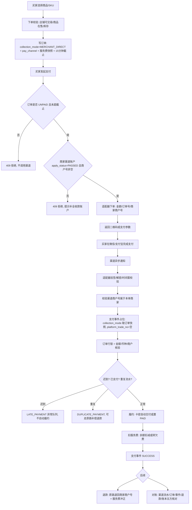
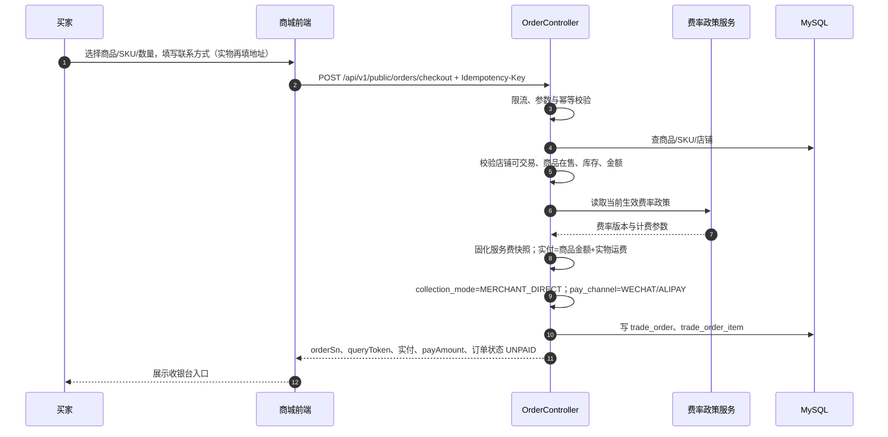
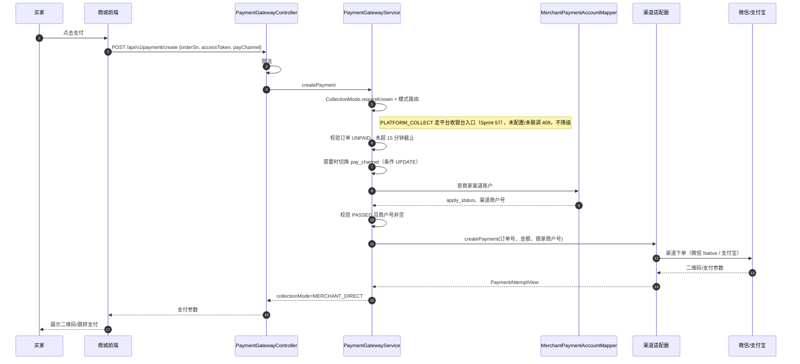
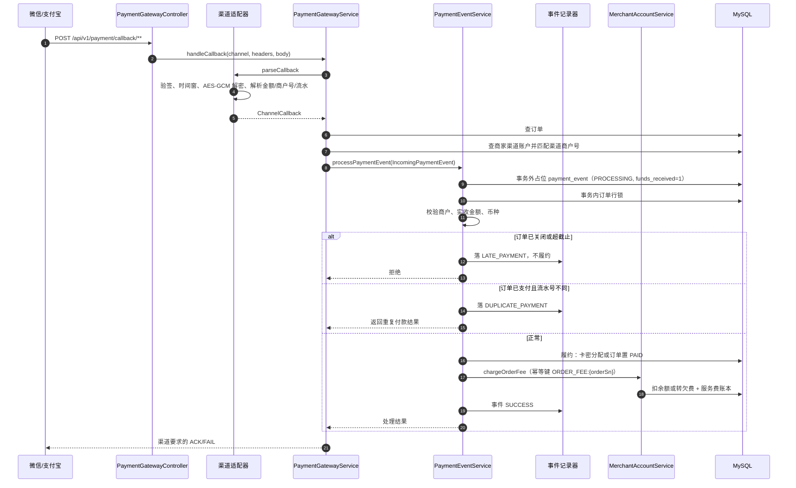
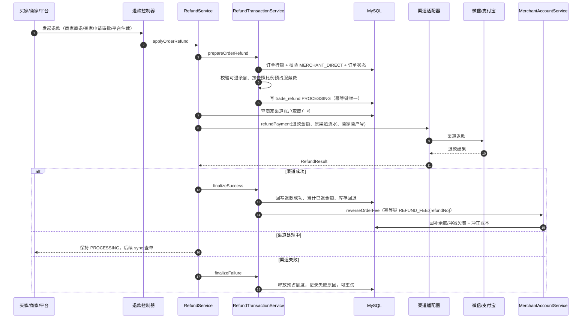
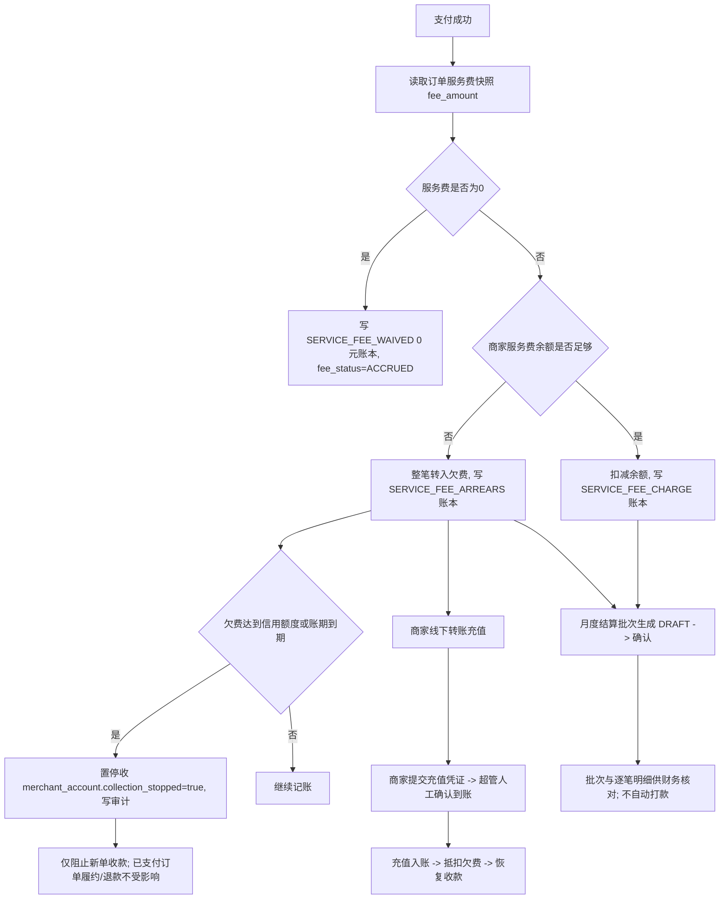
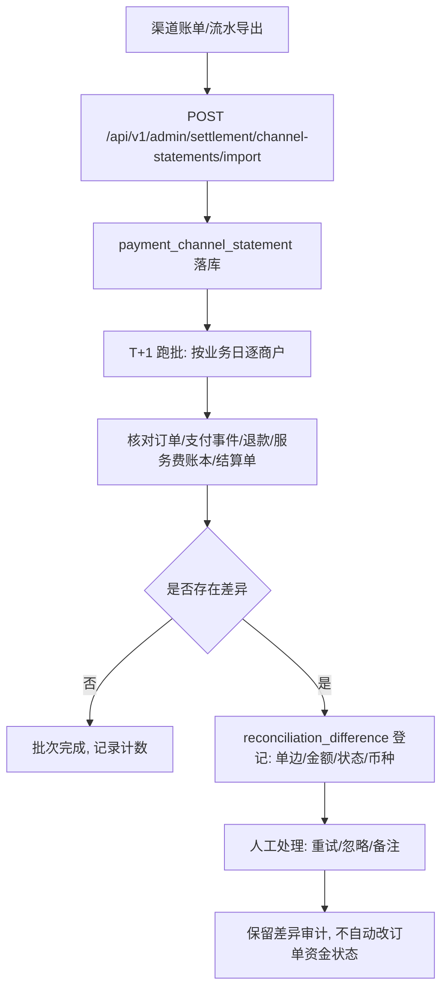
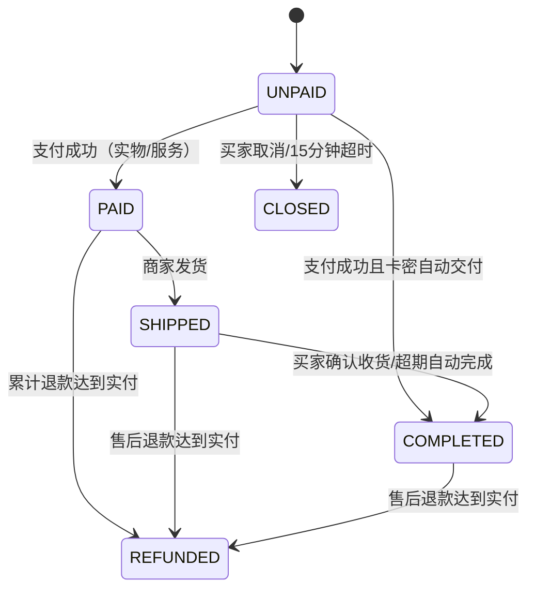

<!--
文件：2026-11-08-商家收款双轨与微信电商收付通进件设计.md
用途：定义“商家直收 / 平台代收后官方分账”双轨并行、按商家一键切换、微信电商收付通进件与分账的决策登记、资金边界、数据模型、接口契约、模块拆分和验证边界。
维护注意：
  1. 本文是设计与决策记录，不代表代码已实现；每个模块落地后必须同步对应 Sprint 文档与台账状态。
  2. 平台代收再分账必须由微信/支付宝等持牌机构完成，平台不得形成资金池；没有服务商资质与真实凭据前不得宣称联调通过。
  3. 收款模式只对新订单生效，订单快照为准；在途订单、退款不得中途改道。
  4. 服务费可以配置为 0，但不得把“0 服务费”写成“平台不参与资金流”或“已完成分账”。
  5. 本文不复制任何真实商户号、证书、密钥、银行卡号或身份证号。
-->
# 商家收款双轨与微信电商收付通进件设计

- 日期：2026-11-08
- 关联台账：F02/F03（支付渠道与分账）、T40（平台代收与分账骨架）、T39（收款账户与费率）
- 执行方：代码代理（设计、实现、用例、静态审阅）
- 当前状态：设计已确认；M1（总闸、商家模式、切换前置校验、切换审计、生效模式解析）、M2（商家收款账户页真实状态展示）、M3（管理端总闸与切换页面）、M4-A（下单收款模式快照与平台代收就绪校验，含三条建单入口）与 M4-B 退款骨架（平台收银台退款/退分契约、先退分后退款编排、退款入口 409 细化；渠道 mock 501）已实现，待人工验证；**Sprint 59（M6 联调准备阶段 ✅ 已完成，2026-11-10）**：真实微信电商收付通适配器、平台代收回调独立入口与台账接线、退款/退分报文 sub_mchid 接线已就绪（占位 mock 删除）；分账发起（D3 时点）与 M5（对账、分账异常队列、灰度）未实现；**M6 真实渠道联调 ⏳ 等待真实服务商凭据**，联调清单见 SPRINT_59。3.3 节已补 MERCHANT_DIRECT 商家直收全流程（资金边界、技术实现、模块职责、时序图、流程图、异常分支、代码落点与接入清单）。M1 实际范围与未验证项见 [SPRINT_51](SPRINT_51_商家收款双轨模式开关与切换审计.md)；M4-B 见 [SPRINT_58](SPRINT_58_平台代收退款先退分后退款骨架.md)；M6 准备见 [SPRINT_59](SPRINT_59_微信电商收付通真实适配器与M6联调准备.md)

## 1. 目标与范围

本轮把“商家怎么收钱、平台怎么把净额给商家”做成标准做法，分两条并行轨道：

1. `MERCHANT_DIRECT`：买家货款直接进入商家自己的微信/支付宝商户号，平台不碰货款；
2. `PLATFORM_COLLECT`：买家货款进入平台服务商商户号，由微信/支付宝按分账指令结算给商家二级商户，平台按费率留存服务费。

两条轨道由平台运营按商家一键切换，粒度到单商家；切换只影响新订单。

明确不在本轮范围：

- 平台自建余额、商家提现、平台直接代付到银行卡；
- 支付宝直付通真实联调（后续模块）；
- 发票、税务代扣代缴；
- 真实渠道资质申请。

## 2. 已确认决策

| 编号 | 决策 |
| --- | --- |
| C1 | 双轨并行：`MERCHANT_DIRECT` / `PLATFORM_COLLECT` |
| C2 | 平台运营可运行时切换，粒度到单商家；环境变量只保留应急强制关闭 |
| C3 | 只对新订单生效，订单创建时快照 `trade_order.collection_mode` |
| C4 | 先接微信电商收付通，支付宝后续 |
| C5 | 服务费可配置为 0；分账公式“平台留成 = min(服务费, 实收)，商家净额 = 实收 − 留成” |
| S2 | 切换权限仅 `SUPERADMIN` + 审计；切到平台代收不做双人复核 |
| S3 | 切到平台代收前强制校验渠道进件已绑定，不满足直接拒绝，不做“先切后补” |
| S4 | 渠道优先级：微信电商收付通优先 |
| S5 | 当前按“无真实微信服务商/收付通凭据”处理：本轮做适配器与沙箱 mock，真实联调单列 |
| S6 | 微信账号类型待确认；电商收付通必须是服务商模式，普通商户号不满足 |

### 2.1 设计默认（用户已同意按此执行）

| 编号 | 默认值 |
| --- | --- |
| D1 | 平台服务商代进件：平台收集资料提交微信，回写 `sub_mchid` 与渠道状态 |
| D2 | 结算账户以微信侧为准，平台只存脱敏镜像与审计，不重复收集完整卡号 |
| D3 | 分账时点为订单完成且售后期结束后，不在支付成功时立即分账 |
| D4 | 退款顺序：先退分、后退款，金额守恒、同一退款幂等 |
| D5 | 分账失败有限重试后进入人工队列，不自动回退订单支付状态 |
| D6 | 平台留成 = `min(服务费, 实收)`，服务费 0 时全额分账 |
| D7 | 灰度沿 Q09-A：资质 + 商家名单，可按商家回滚 |
| D8 | 页面展示渠道进件状态 + 脱敏结算卡，删除空对象兜底“审核中”和写死的“中国工商银行” |
| D9 | 数据模型：`merchant_store.collection_mode` + 切换审计表 + 运行时可配置总闸 |
| D10 | 银行卡/账号/`sub_mchid` 按密文或脱敏存储，操作全审计，最小权限 |

## 3. 资金流与合规边界

### 3.1 商家直收（现有能力）

```
买家 → 商家微信/支付宝商户号 → 商家结算账户
平台只按订单收取技术服务费，不接触货款
```

### 3.2 平台代收 + 微信电商收付通分账（目标能力）

```
买家 → 平台服务商商户号（微信）
     → 按分账指令 → 商家二级商户 sub_mchid 的结算银行卡
     → 平台留存服务费（可为 0）
```

约束：

- 平台必须是微信支付服务商，商家以二级商户进件取得 `sub_mchid`；
- 资金结算由微信完成，平台只发分账/退分指令，不形成资金池；
- 不能把微信收的货款分给商家的支付宝账户；渠道之间不可交叉；
- 没有服务商资质或真实凭据时，只能做适配器、沙箱 mock 与契约测试。

### 3.3 MERCHANT_DIRECT（商家直收）的处理方式

本节把商家直收讲成可执行的技术方案：资金边界、技术选型、模块职责、时序、异常分支、数据语义和代码落点。它是当前代码的基线能力，M1–M6 只新增平台代收轨道，不改变本节路径。

#### 3.3.1 一句话定义

买家在收银台使用商家自己的微信/支付宝商户号完成支付，货款由渠道直接结算到商家的渠道账户或商家绑定的结算银行卡；平台不接收、不代持、不分账、不形成资金池。平台只按订单快照计算技术服务费，通过商家预充值余额扣减、欠费记账和月度结算批次回收，与货款渠道完全分离。

#### 3.3.2 资金与职责边界

| 事项 | MERCHANT_DIRECT 的处理 | 明确不做 |
| --- | --- | --- |
| 收款商户号 | 使用订单所属商家在渠道侧登记的商户号（微信 `mchid` / 支付宝 `seller_id`），代码中复用 `merchant_payment_account.sub_mchid` 承载该值 | 不使用平台服务商商户号，不使用电商收付通二级商户号 |
| 货款去向 | 渠道直接结算给商家；平台不接触货款 | 平台余额、商家提现、平台代付银行卡 |
| 平台收入 | 订单服务费快照；余额扣减或欠费记账，线下充值/月结回收 | 不从货款中直接截留，不做“平台先收再分” |
| 分账 | 不生成 `platform_collection_settlement`、`split_detail`、`split_reverse` | 不调用微信 `profitsharing`，不发送分账/退分指令 |
| 退款 | 原路退回商家渠道商户号；退款金额与服务费冲正按订单快照计算 | 平台账户代付退款，跨渠道退款 |
| 订单快照 | 下单时写 `trade_order.collection_mode=MERCHANT_DIRECT`，支付、回调、退款都按该快照校验 | 支付后改模式，静默降级或回退 |
| 平台代收订单 | `PaymentGatewayService` 对 `PLATFORM_COLLECT` 显式返回 409，不进入直收路径 | 把平台代收订单当作商家直收处理 |

结论：两条轨道共用订单、支付事件、退款、对账骨架，但**收款商户号、资金流、分账表和平台收入来源不同**。M1 只增加模式开关与审计，不改变本节任何资金路径。

#### 3.3.3 技术栈与依赖

| 层 | 技术 | 在本路径中的作用 |
| --- | --- | --- |
| 后端框架 | Spring Boot 3、Jakarta Servlet、Spring Transaction | 下单、支付、回调、退款的事务边界与行锁 |
| 持久层 | MyBatis-Plus、MyBatis Mapper、MySQL 8 | 订单/事件/退款/账户/账本落库；条件 UPDATE 做 CAS 与幂等 |
| 鉴权 | Sa-Token | 买家公开接口、商家店长/员工、平台超管三层权限 |
| 微信支付 | 微信支付 APIv3：RSA-SHA256 商户签名、平台公钥验签、AES-256-GCM 解密、Native 下单 | 商家直收下单、回调验签解密、查单、关单、退款 |
| 支付宝 | 支付宝适配器契约（当前与微信同接口） | 商家直收下单、回调解析、查单、关单、退款 |
| HTTP | `RestTemplate` + 渠道统一异常翻译 | 调用渠道 API，区分网络错误、HTTP 错误和业务错误 |
| 金额 | `BigDecimal` 两位小数、分/元换算 `long` | 禁止浮点；渠道报文“分”与库内“元”显式换算 |
| 异步与任务 | Spring `@Scheduled`、退避重试、回执表 | 超时关单、渠道关单重试、支付异常补偿扫描、T+1 对账 |
| 审计 | `payment_callback_audit`、`payment_close_receipt`、`payment_exception_disposition` | 回调结果、关单结果、异常人工处置只增不改 |
| 前端商城 | Vue 3、Vite 5、Pinia、Tailwind | 商品详情、收银台、免密查单 |
| 前端后台 | Vue 3、Vite 5、Element Plus | 商家订单/退款/账单，平台财务/商户/订单 |
| 共享规则 | Node `node --test`、`shared/*.mjs` | 幂等、订单取消、退款、服务费展示等纯函数规则 |
| 部署 | Nginx 模板、部署脚本 | 商城/后台静态资源、`/api` 反代、支付回调公网可达 |

#### 3.3.4 模块职责矩阵（后端）

| 模块/类 | 负责什么 | 关键约束 |
| --- | --- | --- |
| 入驻与店铺（`MerchantOnboardingService`、`MerchantStoreGuard`、`MerchantStoreStatusService`） | 商家准入、店铺状态、可交易校验 | 未通过/冻结/打烊店铺不得下单；状态变更全审计 |
| 商品与分类（`ProductController`、`ProductEditingService`、`ProductModerationService`、`CategoryController`） | 商品/分类维护、在售状态、违规下架 | 下单只认在售商品与真实价格；违规商品不得交易 |
| 库存与卡密（`InventoryReservationService`、`CardAssetService`、`CardCipherService`） | SKU 库存校验/预占释放、卡密加密存储与分配 | 下单只校验不扣减；卡密不落明文日志；履约失败不得伪造交付 |
| 认证与权限（`AuthController`、`AuthSessionService`、`SaTokenConfigure`） | 买家/商家店长/员工/平台超管登录态与接口拦截 | 资金操作仅店长或超管；支付回调不依赖登录态 |
| 通知（`MerchantNotificationService`、`merchant_notification_outbox`） | 支付成功、退款、异常、账单通知 | 不外发卡号/证件/密钥；SMS 通道默认禁用 |
| 财务审批（`FinanceApprovalGuard`、`DualApprovalAccountValidator`） | 充值确认、账户变更等敏感操作复核 | 复核规则在服务端；前端不得自行放行 |
| 结算账户与账单（`MerchantSettlementAccountService`、`BillingStatementService`、`SaasFeeBillService`） | 收款账户登记核验、服务费账单、SaaS 费用 | 敏感卡号脱敏；无记录显示未配置，不伪造审核状态 |
| `OrderController` | 公开下单 `/api/v1/public/orders/checkout`；生成订单号与查单凭证、校验商品/店铺/库存、计算实付、写服务费快照 | 下单不扣库存、不履约；`collection_mode` 固定 `MERCHANT_DIRECT`；15 分钟截止时间落库 |
| `PeerPayServiceImpl` | 代付/推单场景创建订单 | 同样固定 `MERCHANT_DIRECT`，不得写成平台代收 |
| `ServiceFeeSnapshotService`、`MerchantFeePolicyService` | 读取当前生效费率政策，把费率、基数、服务费、税额固化到订单 | 费率调整不回溯已下单订单；运费不计入服务费基数 |
| `PaymentGatewayController` | 买家发起支付 `/api/v1/payment/create`；微信/支付宝异步通知 `/api/v1/payment/callback/**` | 回调端点公网可达但不依赖登录态，安全性完全依赖适配器验签 |
| `PaymentGatewayService` | 发起支付前校验：模式、订单状态、支付截止、渠道账户、金额；回调时校验渠道商户号；查单与关单 | `PLATFORM_COLLECT` 走平台收银台骨架入口（Sprint 57），未配置/未联调 409；不做隐式降级 |
| `PaymentChannelRegistry` | 按渠道编码选择适配器 | 未知渠道拒绝；适配器未启用时明确报错 |
| `WeChatPaymentChannelAdapter` | 微信 Native 下单、回调验签/解密、查单、关单、退款、退分查单 | 商户号取商家账户值；时间窗 ±300 秒防重放；禁止用订单金额反填 |
| `AlipayPaymentChannelAdapter` | 支付宝同契约实现 | 与微信共用订单/事件模型，不共享商户号与资金 |
| `PaymentEventServiceImpl` | 支付事件占位、订单行锁、金额/币种/商户核验、迟到/重复判定、履约、触发扣费 | 事件先占位后履约；`collection_mode` 取订单快照；`platform_trade_no` 保持空 |
| `MerchantAccountService` | 支付成功扣服务费、余额不足转欠费、退款冲正、线下充值、欠费停收/恢复 | 幂等键 `ORDER_FEE:{orderSn}` / `REFUND_FEE:{refundNo}`；停收只影响新单 |
| `RefundService`、`RefundTransactionService` | 商家直退、买家申请审批后的退款、重复付款补偿；预占额度、原路退款、成功回写、库存回退 | 按订单 `collection_mode` 快照路由：直收原路退回商家渠道账户；平台代收走平台收银台先退分后退款编排（M4-B，退分额=退款额−服务费冲正，退分未完成中止退款，绝不回退直收）；同一订单幂等键；退款成功才冲正服务费 |
| `MerchantPaymentController` | 商家查单/关单 | 仅 `SUPERADMIN`/`MERCHANT_ADMIN`，且校验订单归属 |
| `MerchantRefundController`、`MerchantRefundRequestController`、`BuyerRefundRequestController` | 商家退款、买家退款申请、商家审批 | 买家凭订单号+联系方式+查单凭证；金额不得超可退余额 |
| `PlatformCollectionService` | 平台代收结算/分账/退分骨架 | 明确拒绝 `MERCHANT_DIRECT` 订单；默认关闭，无真实渠道时不启用 |
| `SettlementService` | 月度服务费结算批次生成/确认、逐笔明细 | 只做账务汇总与确认，不调用渠道打款 |
| `ReconciliationService`、`ReconciliationBatchService` | 渠道流水导入、五方对账、差异队列、T+1 跑批 | 差异只登记与处理，不自动改订单资金状态 |
| `AdminSettlementController`、`MerchantSettlementController` | 平台/商家侧服务费账户、充值、批次、对账查询 | 跨店查询必须显式传商户；出参不返回渠道报文与敏感凭据 |

#### 3.3.5 模块职责矩阵（前端、共享规则与部署）

| 模块 | 负责什么 | 关键约束 |
| --- | --- | --- |
| `shop-storefront-vue` `Home.vue`、`Store.vue` | 商品大厅、店铺主页、分类与商品陈列 | 只展示后端返回的真实在售商品；不参与下单资金计算 |
| `shop-storefront-vue` `ProductDetail.vue` | 商品详情、SKU 选择、下单入口、实物地址 | 只展示真实可售与价格，不伪造支付能力 |
| `shop-storefront-vue` `PeerPayCashier.vue` | 代付/收银台、扫码支付、预占释放 | 支付参数来自后端；不拼接渠道商户号，不写死金额 |
| `shop-storefront-vue` `QuickQuery.vue` | 免密查单、取消未支付单、售后入口 | 凭订单号+联系方式+查单凭证；不在前端存储敏感凭据 |
| `shop-admin-vue` `admin/Onboarding.vue`、`onboarding/ApplyWizard.vue` | 入驻资料提交、平台审核、补充材料 | 审核结论只由平台操作，前端不得伪造通过 |
| `shop-admin-vue` `merchant/Products.vue`、`merchant/Cards.vue` | 商家商品/SKU 维护、卡密导入与库存查看 | 价格/库存以后端校验为准；卡密明文不在列表展示 |
| `shop-admin-vue` `admin/ProductModeration.vue` | 平台商品违规下架与恢复 | 处置必须填原因，全量审计 |
| `shop-admin-vue` `merchant/Complaints.vue`、`admin/Complaints.vue` | 投诉/售后处理与平台仲裁 | 处理结论与退款动作分离，不伪造退款成功 |
| `shop-admin-vue` `merchant/SaasFee.vue`、`admin/SaasFee.vue` | SaaS 服务费账单查看与平台核对 | 只读展示真实账单，不前端计算欠费 |
| `shop-admin-vue` `merchant/Orders.vue` | 商家订单列表、发货、查单/关单入口 | 金额与状态以后端为准；员工无资金操作权限 |
| `shop-admin-vue` `merchant/RefundRequests.vue` | 买家退款申请审批 | 同意走原路退款，拒绝必须填原因 |
| `shop-admin-vue` `merchant/Billing.vue`、`Profile.vue` | 商家账单/服务费、店铺与收款资料 | 无记录显示“未配置/未进件”，不写死银行名或假“审核中” |
| `shop-admin-vue` `admin/Finance.vue` | 平台充值确认、结算批次、对账差异、支付异常队列与处置 | 处置只记录结论，不改资金状态；复核人按服务端规则 |
| `shop-admin-vue` `admin/Merchants.vue`、`admin/Orders.vue` | 平台商户/订单只读与处置入口 | 跨店操作必须明确商户；敏感字段脱敏 |
| `shared/*.mjs` | 幂等、订单取消、退款、服务费、订单列表、结算展示等纯规则 | 前后端同口径；规则变更必须同步 `node --test` 用例 |
| `deploy` | Nginx 反代、静态资源、回调域名、探针、构建产物 | 支付回调必须公网可达；不把渠道密钥写入仓库或前端 |

#### 3.3.6 端到端流程图



#### 3.3.7 时序图：下单与收款模式快照



关键点：`collection_mode` 在下单时固化，后续支付、回调、退款都只读订单快照；下单事务不扣库存、不履约、不生成海报。

#### 3.3.8 时序图：发起支付



关键点：支付参数中的商户号来自商家账户，不使用平台商户号；金额取订单实付，不由前端传入；渠道未启用或缺商户号时明确 409/503，不伪造二维码。

#### 3.3.9 时序图：支付回调、履约与扣服务费



关键点：回调先验签再落账；事件占位在业务事务之外，避免并发重放重复履约；金额缺失直接拒绝，不从订单反填；履约与扣费在同一业务事务提交；审计写入失败不改变回调结果。

#### 3.3.10 时序图：退款与费用冲正



关键点：退款只能退到原渠道商家商户号；退款成功才冲正服务费；已交付卡密按既有规则作废/补发，不因退款重复发卡；平台代收订单不得进入该退款路径。

#### 3.3.11 服务费如何回收（平台不碰货款）



说明：

- 平台在商家直收下没有货款可截留，服务费只能走“商家预充值 + 欠费 + 月结账单”的应收链路；
- 充值确认是人工核对到账，不是渠道自动扣款；
- 结算批次只做账务汇总与确认，不调用银行或渠道打款；
- 欠费停收是新增订单闸门，不改变已支付订单的履约、退款和售后。

#### 3.3.12 对账流程



关键点：跑批按不可变时间字段切日（退款用 `success_at`），不按会被改写的 `updated_at`；渠道流水导入与差异处理都不直接修改订单/退款/账本金额。

#### 3.3.13 状态机与数据语义

订单状态：



支付事件状态（`payment_event.event_status`）：`PROCESSING`、`SUCCESS`、`FULFILLMENT_FAILED`、`DUPLICATE_PAYMENT`、`LATE_PAYMENT`，拒绝类还包括金额/币种/商户不符等。`funds_received=1` 表示渠道侧存在该笔资金往来，应当有对应渠道流水；不得用 `0/NULL` 表达已知到账。

退款状态（`trade_refund.status`）：`PROCESSING → SUCCESS / FAILED`；成功时写不可变 `success_at`；失败可复用同一条记录重试，但必须重新预占额度。

服务费状态：订单级 `trade_order.fee_status` 使用 `OrderFeeStatus`（`PENDING/ACCRUED/ARREARS/...`）；商家账户级 `merchant_account` 有可用余额、欠费、信用额度、账期与停收标记；两者不是同一套编码，展示时不得混用。

关键字段语义：

| 表.字段 | MERCHANT_DIRECT 下的语义 |
| --- | --- |
| `trade_order.collection_mode` | 固定 `MERCHANT_DIRECT`，下单快照，支付/退款只读 |
| `trade_order.pay_channel` | 真实渠道 `WECHAT`/`ALIPAY`，发起支付时可在 UNPAID 阶段条件切换 |
| `trade_order.pay_trade_no` | 商家直收渠道流水号 |
| `trade_order.platform_trade_no` | 必须为空；不得用商家直收流水回填 |
| `trade_order.fee_*` | 订单级服务费快照；费率调整不回溯 |
| `trade_order.lock_expire_time` | 下单起算 15 分钟支付截止；预占成功不重置 |
| `merchant_payment_account.sub_mchid` | 商家自己的渠道商户号；命名沿用历史预留，不代表平台二级商户 |
| `merchant_payment_account.apply_status` | 必须 `PASSED` 才可发起支付/关单；平台不得直接伪造 |
| `merchant_payment_account.binding_status` | 商家直收不使用；留给平台代收分账接收方 |
| `payment_event.collection_mode` | 取订单快照；不得改写 |
| `payment_event.channel_merchant_id` | 渠道返回的商户号，用于核验归属 |
| `payment_event.platform_trade_no` | 必须为空 |
| `trade_refund.collection_mode` | 取订单快照；非 `MERCHANT_DIRECT` 拒绝进入直收退款 |
| `trade_refund.channel_trade_no` / `channel_refund_no` | 原支付流水与渠道退款流水 |
| `merchant_account_ledger` | 服务费扣减/欠费/冲正/充值账本；幂等键唯一 |
| `merchant_recharge_order` | 线下充值凭证与人工确认；不是渠道自动扣款 |
| `merchant_settlement_batch` / `merchant_settlement_item` | 月度服务费结算汇总；不自动打款 |
| `payment_channel_statement` | 渠道流水导入；对账数据源 |
| `reconciliation_batch_run` / `reconciliation_difference` | T+1 跑批记录与差异队列 |

#### 3.3.14 代码落点（按调用链）

| 阶段 | 文件 | 方法/入口 |
| --- | --- | --- |
| 下单 | `shop-b2b2c-backend/src/main/java/com/shop/b2b2c/controller/OrderController.java` | `checkoutRequest` / `checkout` |
| 代付建单 | `.../service/impl/PeerPayServiceImpl.java` | 创建订单处固定 `MERCHANT_DIRECT` |
| 服务费快照 | `.../service/ServiceFeeSnapshotService.java`、`.../service/MerchantFeePolicyService.java` | `apply`、`getEffectivePolicy` |
| 发起支付 | `.../controller/PaymentGatewayController.java` | `createPayment` |
| 支付编排 | `.../service/payment/PaymentGatewayService.java` | `createPayment`、`handleCallback`、`queryPayment`、`closePaymentBestEffort` |
| 渠道适配 | `.../service/payment/PaymentChannelRegistry.java`、`WeChatPaymentChannelAdapter.java`、`AlipayPaymentChannelAdapter.java` | `createPayment`、`parseCallback`、`queryPayment`、`closePayment`、`refundPayment` |
| 回调履约 | `.../service/impl/PaymentEventServiceImpl.java` | `processPaymentEvent`、`claimEvent`、`processInTransaction` |
| 服务费扣减 | `.../service/MerchantAccountService.java` | `chargeOrderFee`、`reverseOrderFee`、`createRecharge`、`confirmRecharge`、`requireCollectionAllowed`、`evaluateDueArrears` |
| 退款 | `.../controller/MerchantRefundController.java`、`MerchantRefundRequestController.java`、`BuyerRefundRequestController.java`；`.../service/payment/RefundService.java`、`RefundTransactionService.java` | `applyOrderRefund`、`prepareOrderRefund`、`finalizeSuccess`、`syncRefund` |
| 查单/关单 | `.../controller/MerchantPaymentController.java` | `queryPayment`、`closePayment` |
| 平台代收拒绝 | `.../service/PlatformCollectionService.java` | `enabled`、`prepareSettlement`、`requireSettlement`、`requireBoundReceiver`；只接受 `PLATFORM_COLLECT` 订单 |
| 结算/对账 | `.../service/SettlementService.java`、`ReconciliationService.java`、`ReconciliationBatchService.java`；`AdminSettlementController`、`MerchantSettlementController` | 批次生成/确认、流水导入、跑批、差异处理 |
| 商城前端 | `shop-storefront-vue/src/views/ProductDetail.vue`、`PeerPayCashier.vue`、`QuickQuery.vue` | 下单、收银台、查单 |
| 后台前端 | `shop-admin-vue/src/views/merchant/Orders.vue`、`RefundRequests.vue`、`Billing.vue`、`Profile.vue`；`views/admin/Finance.vue`、`Merchants.vue`、`Orders.vue` | 商家/平台操作入口 |
| 共享规则 | `shared/idempotency.mjs`、`orderCancel.mjs`、`refundRequest.mjs` 及对应 `*.test.mjs` | 纯规则与回归 |

#### 3.3.15 异常分支处理矩阵

| 场景 | 判定位置 | 落库/结果 | 后续动作 |
| --- | --- | --- | --- |
| 未知/非法收款模式 | `CollectionMode.requireKnown` | 400，不落资金数据 | 拒绝，不降级 |
| 平台代收订单进入直收支付 | `PaymentGatewayService.createPayment` | 409 | 走平台代收轨道（M4 后），当前拒绝 |
| 商家渠道账户缺失/未审核/无商户号 | `requireAccount` | 409 | 商家补资料/平台审核（M2/M3） |
| 超过 15 分钟支付截止 | `createPayment` | 409 | 买家重新下单；关单任务关闭旧单 |
| 回调验签/时间窗/解密失败 | 渠道适配器 | 401/400，写回调审计 | 渠道重试；不落账 |
| 渠道商户号与订单商家不符 | `requireSameMerchant` | 401 | 拒绝；审计留痕 |
| 实收金额/币种与订单不符 | `PaymentEventServiceImpl` | 事件拒绝态 | 异常队列人工核对；不自动改资金 |
| 订单已关闭后到账 | `PaymentEventServiceImpl` | `LATE_PAYMENT` | 异常队列；退款/补偿须走渠道或既有退款流程 |
| 已支付订单收到不同流水 | `PaymentEventServiceImpl` | `DUPLICATE_PAYMENT` | 商家/平台发起重复付款原路补偿 |
| 卡密库存不足/已被分配 | `PaymentEventServiceImpl` | `FULFILLMENT_FAILED` | 人工审核；不得伪造交付 |
| 退款渠道失败 | `RefundService` | `FAILED`，释放预占 | 可重试；不得标记成功 |
| 退款后服务费冲正 | `reverseOrderFee` | 账本冲正（幂等） | 余额/欠费回补；不重复冲正 |
| 关单失败 | `closePaymentBestEffort` | `payment_close_receipt=FAILED` | 退避重试；本地订单仍按超时关闭 |

#### 3.3.16 与 PLATFORM_COLLECT 的差异

| 维度 | MERCHANT_DIRECT | PLATFORM_COLLECT |
| --- | --- | --- |
| 收款商户号 | 商家自己的渠道商户号 | 平台服务商商户号，商家为二级商户 `sub_mchid` |
| 货款去向 | 渠道直接结算给商家 | 平台服务商收款，微信按分账指令结算给商家 |
| 平台收入 | 服务费余额/欠费/月结回收 | 从代收货款中按分账指令留存服务费（可为 0） |
| 前置条件 | 商家渠道账户 `apply_status=PASSED`、商户号非空 | 服务商资质、电商收付通权限、`binding_status=BOUND`、`sub_mchid`、`settlement_account_id` 非空 |
| 分账表 | 不使用 | `platform_collection_settlement`、`split_detail`、`split_reverse` |
| 退款 | 原路退回商家商户号 | 先退分后退款，金额守恒 |
| 订单快照 | `collection_mode=MERCHANT_DIRECT` | `collection_mode=PLATFORM_COLLECT` |
| 开关 | 默认路径，无额外总闸 | 全局总闸 + 商家模式 + 环境变量应急关闭 |
| 失败处理 | 渠道失败/关单重试/异常队列 | 分账失败有限重试后人工队列，不自动回退支付状态 |
| 当前状态 | 代码基线已存在，真实渠道待凭据联调 | 骨架与 M4 下单快照已接入；平台收银台/账单/分账真实联调未开始（M6） |

#### 3.3.17 当前缺口与上线前置

1. 商家渠道账户写入流程（M2/M3）尚未完成；当前直收依赖 `merchant_payment_account` 已有数据，不能把“账户不存在”当成“已开通”。
2. `Profile.vue` 等页面存在无记录显示假“审核中”、写死“中国工商银行”的问题，必须在 M2 删除，改为“未进件/未配置”并展示真实状态。
3. 微信/支付宝真实商户号、APIv3 密钥、商户私钥、平台公钥未配置时，适配器 `enabled=false`，支付会明确失败；不得用 mock 二维码冒充真实支付。
4. 真实微信/支付宝商家直收的支付、回调验签/解密、查单、关单、退款未在真实环境联调；H2 与 Mockito 用例不能替代渠道联调。
5. 订单/支付事件/退款/账本在真实 MySQL 8 的并发、行锁、唯一索引与回调重放未演练。
6. M4 已接通下单快照：建单按生效模式写 `trade_order.collection_mode`，平台代收未启用或绑定未就绪时 409 拒绝建单，不降级；但平台代收的支付发起、回调验签、台账生成与分账/退分仍依赖服务商商户号与平台收银台配置，代码未接入，M6 前不得宣称平台代收可用。
7. 支付宝直付通与分账未开始，后续模块单列，不得宣称已支持。

#### 3.3.18 商家直收接入清单（部署与配置）

| 项目 | 要求 | 说明 |
| --- | --- | --- |
| 公网回调地址 | `payment.channel.notify-base-url=https://<公网域名>` | 为空时禁止发起渠道下单；最终回调为 `/api/v1/payment/callback/wechat` 或 `/alipay` |
| 微信渠道 | `payment.channel.wechat.enabled=true`；`app-id`、`serial-no`、`api-v3-key`、`private-key`、`platform-public-key` | 凭据只来自环境变量/部署密钥；证书文件权限最小化，不入库、不入日志 |
| 支付宝渠道 | `payment.channel.alipay.enabled=true`；`app-id`、`private-key`、`alipay-public-key`、`gateway-url` | 与微信独立配置；未启用时明确拒绝，不生成假支付参数 |
| Mock 开关 | `payment.channel.mock-enabled=false` | 仅本地联调；生产必须关闭，且不存在 MOCK 落账适配器 |
| Nginx/网关 | HTTPS、回调路径不被登录拦截、请求体大小与超时满足渠道要求 | 回调必须公网可达；反向代理不得改写签名相关请求头/请求体 |
| 商家账户 | `merchant_store.status` 可交易；`merchant_payment_account.apply_status=PASSED` 且渠道商户号非空 | 账户资料由 M2/M3 写入与审核，平台不得直接伪造 PASSED |
| 渠道后台 | 商户号与 `appid` 绑定、回调地址登记、APIv3 密钥与证书就绪 | 渠道侧配置错误会直接导致下单/验签失败，需纳入上线检查 |
| 上线自检 | 下单→支付→回调→履约→退款→对账全链路沙箱验证 | 无真实凭据时只能验证契约与 mock，不得标记“联调通过” |

## 4. 开关与生效规则

### 4.1 两层开关

1. 全局总闸（运行时可配置，落在数据库 `platform_collection_config.enabled`，管理端可改）；
2. 商家级 `merchant_store.collection_mode`，默认 `MERCHANT_DIRECT`。

生效模式：

```
effective = 全局总闸开启 && 商家模式 = PLATFORM_COLLECT
           ? PLATFORM_COLLECT
           : MERCHANT_DIRECT
```

环境变量 `shop.settlement.platform-collect-enabled=false` 作为应急强制关闭：为 false 时无视数据库总闸，新订单全部回退商家直收；在途平台代收订单仍按快照处理。

**双闸口径（2026-11-09 确认，问题 4）**：

- `shop.settlement.platform-collect-enabled` = **资质硬闸**（进程级）：代表分账资质与通道联调真实就绪，只有完成真实联调才能打开；Sprint 55 起还作为切平台代收的切换前置，未启用时禁止切换（409“分账通道未启用”）。
- `platform_collection_config.enabled` = **运营灰度总闸**（数据库）：运营按灰度计划开关，可随时关闭回退商家直收。
- 管理端只运营数据库总闸；资质硬闸仅以只读标识呈现（`emergencyDisabled`/`platformCollectEnabled`），不提供运行时修改入口。
- 支付发起侧另有第三层：`payment.platform.*` 平台收银台凭据配置 + `payment.platform.enabled` 联调开关（Sprint 57 骨架）；凭据缺失或未联调时平台代收订单发起支付 409 细化拒绝，与上述两闸独立。

### 4.2 切换规则

- 切到 `PLATFORM_COLLECT` 前置条件（Sprint 55 起）：资质硬闸 `shop.settlement.platform-collect-enabled=true`，且该商家 `merchant_payment_account` 满足
  `binding_status=BOUND`、`sub_mchid` 非空、`settlement_account_id` 非空；
- 不满足返回 409，不写审计、不切换；
- 切回 `MERCHANT_DIRECT` 随时允许；
- 只影响新订单；在途订单、退款按订单快照执行；
- 每次切换写审计：操作人、切换前后模式、原因、时间；
- 仅 `SUPERADMIN`，不做双人复核（本轮已确认）。

### 4.3 不做的事

- 不做静默降级：已标记 `PLATFORM_COLLECT` 的订单不得被当作商家直收处理，支付网关继续显式拒绝；
- 不在订单支付后改模式；
- 不用空对象或默认值伪造“已开通/已验证”。

## 5. 数据模型

### 5.1 复用已有结构

| 结构 | 用途 | 现状 |
| --- | --- | --- |
| `trade_order.collection_mode` | 订单收款模式快照 | 已存在，默认 `MERCHANT_DIRECT` |
| `merchant_payment_account` | 渠道二级商户进件（`sub_mchid`、`binding_status`、`settlement_account_id`） | 已存在，但无写入流程 |
| `merchant_settlement_account` | 平台侧收款账户登记与核验 | 已存在，后端接口齐全、前端未接 |
| `platform_collection_settlement` | 平台代收结算台账骨架 | 已存在，`settled_amount` 保持 0 |
| `split_detail` / `split_reverse` | 分账明细与退分 | 已存在 |
| `merchant_fee_policy` | 服务费费率政策（允许 0） | 已存在 |
| `platform.collect.enabled` | 全局总闸 | 目前仅环境变量，需数据库化 |

### 5.2 M1 新增

1. `merchant_store.collection_mode VARCHAR(24) NOT NULL DEFAULT 'MERCHANT_DIRECT'`；
2. `platform_collection_config`：单行配置（`id=1`、`enabled`、`updated_by`、`updated_at`、`version`）；
3. `merchant_collection_switch_audit`：`merchant_id`、`from_mode`、`to_mode`、`reason`、`operator_id`、`created_at`。

迁移脚本：`V23__merchant_collection_dual_mode.sql`，必须幂等（`information_schema` 判断 + 动态 DDL / `CREATE TABLE IF NOT EXISTS`），不得包含删库、`DROP`、`TRUNCATE`。

## 6. 状态机

### 6.1 渠道进件状态（`merchant_payment_account.apply_status`）

`AUDITING → PASSED / REJECTED`，另加 `binding_status`：

```
UNBOUND → BINDING → BOUND
                 ↘ REJECTED
BOUND → DISABLED
```

只允许渠道真实返回推进；平台不得直接写 `PASSED`/`BOUND`。

### 6.2 收款模式切换

```
MERCHANT_DIRECT ⇄ PLATFORM_COLLECT
```

切到 `PLATFORM_COLLECT` 必须 `binding_status=BOUND`；切回无前置条件；全程审计。

## 7. 接口契约（本轮及后续）

### 7.1 M1

- `GET /api/v1/admin/settlement/collection-config`：读取总闸；
- `PUT /api/v1/admin/settlement/collection-config`：修改总闸（`SUPERADMIN`，必填原因）；
- `GET /api/v1/admin/settlement/merchants/{merchantId}/collection-mode`：读取商家模式；
- `PUT /api/v1/admin/settlement/merchants/{merchantId}/collection-mode`：切换商家模式（`SUPERADMIN`，前置校验 + 审计）；
- `GET /api/v1/admin/settlement/merchants/{merchantId}/collection-switch-audits`：切换历史。

### 7.2 M2/M3

- 商家端：提交渠道进件资料、查看进件状态与脱敏结算账户；
- 管理端：审核进件、提交微信、回写 `sub_mchid`/状态、发起/确认结算账户核验。

### 7.3 M4

- 支付下单按生效模式创建订单；
- 支付成功后按订单快照生成平台代收台账；
- 订单完成 + 售后期后调用微信分账 `profitsharing`；
- 退款先退分再退款。

## 8. 模块拆分

| 模块 | 范围 | 交付 |
| --- | --- | --- |
| M1 | 模型与迁移、运行时总闸、商家模式切换接口与审计、生效模式解析 | schema/V23/H2、实体/Mapper/Service/DTO、单元与 H2 用例 |
| M2 | 商家端进件与收款账户页面 | 提交资料、状态展示、脱敏结算卡、错误态 |
| M3 | 管理端进件审核与模式切换页面 | 审核、提交渠道、切换按钮、审计时间线 |
| M4 | 分账接线 | 订单模式解析、`split_detail`、平台留成、退分、回调幂等 |
| M5 | 对账、失败重试、灰度回滚 | 分账对账、人工队列、按商家回滚 |
| M6 | 真实渠道联调 | 微信服务商凭据、沙箱/生产联调、验收记录 |

每个模块独立完成“实现 → 用例 → 静态审阅 → 文档 → 单独提交”，不一次性铺开。

## 9. 测试矩阵（本轮先列骨架）

商家直收（MERCHANT_DIRECT 基线，回归不得被平台代收改动破坏）：

- 下单：固定写 `MERCHANT_DIRECT`，服务费快照正确，运费不计入服务费基数；
- 发起支付：非 `MERCHANT_DIRECT` 409；账户 `apply_status != PASSED` 或商户号为空 409；超 15 分钟 409；金额取订单实付；
- 回调：验签/时间窗/解密失败拒绝；渠道商户号与订单商家不符拒绝；金额/币种不符拒绝；已关闭订单落 `LATE_PAYMENT`；已支付不同流水落 `DUPLICATE_PAYMENT`；正常履约只执行一次；
- 服务费：余额扣减、欠费转换、0 服务费、退款冲正幂等、欠费停收只影响新单；
- 退款：只退原商家渠道；可退余额、服务费预占、成功回写、失败释放、重复幂等；
- 对账：五方核对、差异登记、跑批不自动改资金状态；
- 前端：无收款账户显示“未配置/未进件”，不显示假“审核中”，不写死银行名。

平台代收与切换：

- 开关：全局开/关 × 商家模式 × 绑定状态；
- 切换：合法切换、缺前置 409、非法模式 400、无权限 401/403、并发切换只落一条审计；
- 订单：只对新订单生效、在途订单不改、PLATFORM 订单不被静默降级；
- 分账：留成 0/非 0、金额守恒、重复分账幂等、退款先退分；
- 页面：无记录显示“未进件”，不显示假“审核中”。

## 10. 未验证边界

- 微信服务商资质、电商收付通权限与 API v3 凭据尚未确认；无凭据时只验证适配器契约与 mock 流程；
- 真实 MySQL 8 上 V23 迁移、索引与并发切换未演练；
- 支付宝直付通未开始；
- 平台代收真实资金流、微信分账/退分联调未验证；
- 前端页面交互与浏览器联调未验证；
- `MERCHANT_DIRECT` 的真实微信/支付宝商户号支付、回调验签/解密、查单、关单、退款未联调；H2/Mockito 用例不能替代渠道联调；
- 商家渠道账户写入流程（M2/M3）未完成，当前直收依赖存量 `merchant_payment_account` 数据；
- 真实 MySQL 8 上订单/支付事件/退款/服务费账本的并发、行锁、唯一索引与回调重放未演练。

## 11. 回滚

- 代码回滚：删除 M1 新增实体/服务/接口，订单继续固定 `MERCHANT_DIRECT`；
- 数据回滚：`merchant_store.collection_mode` 保留列并默认 `MERCHANT_DIRECT` 即可，不删列、不删审计；
- 总闸回滚：数据库总闸置 0 或环境变量置 false，新订单回退商家直收；
- 在途 `PLATFORM_COLLECT` 订单仍按快照处理，不得回滚成直收。
