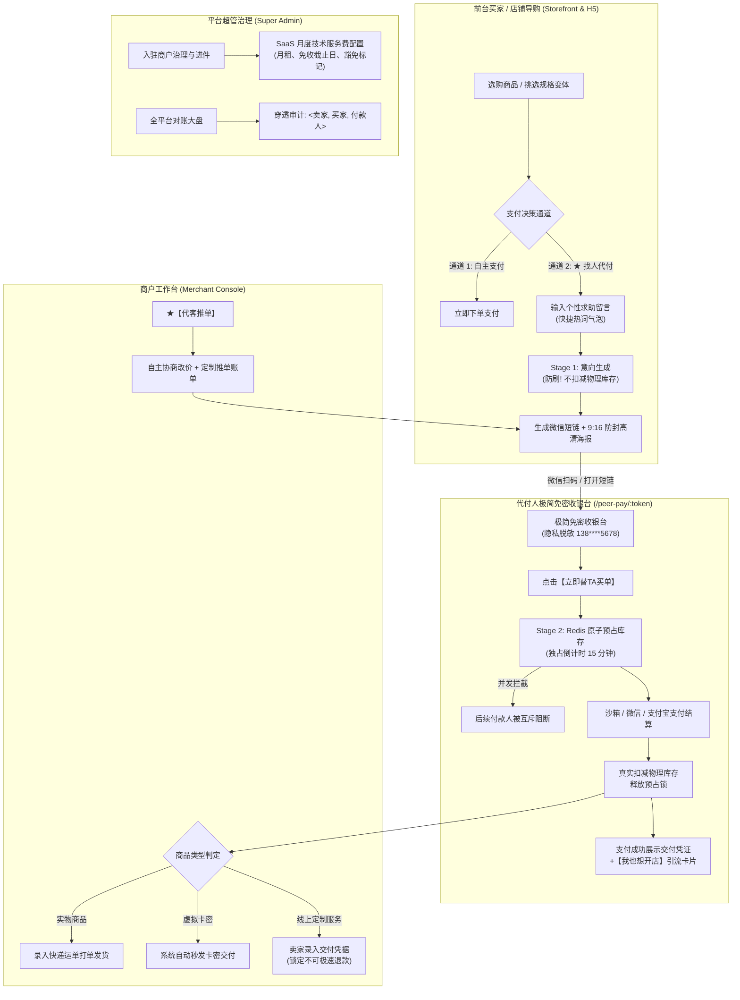

<!--
文件：B2B2C_MVP_PEER_PAY_DELIVERY_REPORT.md
用途：找人代付MVP的历史交付与演示验收记录。
维护注意：此处描述包含规划或历史验收记录，不代表当前代码已全部实现；现状以问题台账及最新Sprint记录为准，旧截图/链接不能替代可重复测试。
-->
# B2B2C 找人代付与两段式库存锁控电商平台 · 全闭环交付报告

> **项目名称**：Shop B2B2C Multi-Tenant E-Commerce Platform (找人代付裂变版)  
> **核心引擎**：找人代付 (Peer Pay) + 卖家代客推单 (Push Pay) + 两段式原子预占库存锁 (Two-Stage Reservation)  
> **商业合规支柱**：商户 SaaS 月度技术服务费 (前期 0 元扶持) + 实物与线上服务双轨履约  
> **代码仓库路径**：`E:\shop-b2b2c`  
> **交付状态**：**Step 1 ~ Step 5 全部 100% 落地并通过自动化端到端验证**

---

## 一、系统整体演进与核心业务闭环

平台已完整建立起**平台超管 (Superadmin)、入驻商户 (Merchant)、前台买家 (Buyer) 与 代付人 (Guest Payer)** 四位一体的闭环体系：



---

## 二、端到端真实交互走查与运行实录

全部界面均已通过无头浏览器与真实测试验证，实录截图存档如下：

### 1. 买家端与代付人收银台闭环

````carousel

<!-- slide -->

<!-- slide -->

<!-- slide -->

<!-- slide -->

<!-- slide -->

````

---

### 2. 商家工作台与超级管理端闭环

````carousel

<!-- slide -->

<!-- slide -->

<!-- slide -->

<!-- slide -->

<!-- slide -->

````

---

## 三、核心技术实现与工程架构

### 1. 行业推荐两段式预占库存引擎 (Two-Stage Reservation)
- **阶段一 (Token 生成)**：
  - 代码位置：[`PeerPayServiceImpl.java`](file:///E:/shop-b2b2c/shop-b2b2c-backend/src/main/java/com/shop/b2b2c/service/impl/PeerPayServiceImpl.java#L40-L100)
  - 仅校验物理库存充盈度，`peerStatus = 'INIT'`，不占真实库存。
- **阶段二 (点击买单原子预占锁)**：
  - 代码位置：[`PeerPayServiceImpl.java`](file:///E:/shop-b2b2c/shop-b2b2c-backend/src/main/java/com/shop/b2b2c/service/impl/PeerPayServiceImpl.java#L230-L280)
  - 通过 Redis `setIfAbsent(peer:lock:ORD..., LOCKED, 15, TimeUnit.MINUTES)` 实现原子互斥。
  - `peerStatus = 'RESERVED_LOCK'`，锁定 15 分钟，其他并发付款人调起时被友好拦截。
- **阶段三 (结算真实扣减与超时自愈)**：
  - 支付成功调用 `notifyPaymentSuccess`，执行 `sku.stockQuantity -= quantity`。
  - 若付款人超时未支付或主动关闭页面，调用 `cancelPreLock` 或由详情接口自愈释放。

### 2. 9:16 微信裂变防封买单海报生成器
- 代码位置：[`PosterUtils.java`](file:///E:/shop-b2b2c/shop-b2b2c-backend/src/main/java/com/shop/b2b2c/common/PosterUtils.java)
- 基于 `ZXing` 高质量二维码编码 + Java AWT 高阶抗锯齿渲染。
- 输出标准 750×1334 像素 9:16 高清电商质感海报，包含：店铺名称徽标、商品主图与标题、代付实付金额、买家好友留言气泡、带参收银台二维码及合规安全背书。

### 3. 三方不可篡改对账台账
- 数据表：[`trade_order`](file:///E:/shop-b2b2c/shop-b2b2c-backend/src/main/resources/schema.sql#L125-L160)
- 每一笔交易同时固化：
  - `merchant_id`: 收款商户
  - `buyer_contact`: 下单买家联系方式 (前台对外脱敏展示为 `138****5678`)
  - `peer_payer_id`: 实际代付付款人标识 (OpenID/流水号)
  - `peer_pay_type`: `0-自主支付` / `1-买家求助代付` / `2-卖家代客推单`
  - `service_voucher`: 线上服务交付凭据

---

## 四、核心 API 接口清单

| 模块 | 方法 | 路径 | 权限 | 说明 |
| :--- | :--- | :--- | :--- | :--- |
| **代付核心** | `POST` | `/api/v1/peer-pay/buyer/create` | 公开 | 买家发起求助代付 (生成短链与海报) |
| **代付核心** | `GET` | `/api/v1/peer-pay/detail/{token}` | 公开 | 免密查询代付详情 (含自愈到期检查与隐私脱敏) |
| **两段式锁** | `POST` | `/api/v1/peer-pay/pre-lock/{token}` | 公开 | 调起收银台原子预占库存 (锁 15 分钟) |
| **两段式锁** | `POST` | `/api/v1/peer-pay/cancel-lock/{token}` | 公开 | 付款人主动离开收银台释放预占库存 |
| **Mock沙箱**| `POST` | `/api/v1/peer-pay/mock-pay/{token}` | 公开 | 沙箱模拟支付回调 (真实扣库存、三方对账) |
| **逆向引流** | `GET` | `/api/v1/peer-pay/success-ad` | 公开 | 获取支付成功页【我也想开店】引流广告位 |
| **商家工作台**| `POST` | `/api/v1/merchant/orders/push-pay` | 商家 | ★ 卖家代客推单 (自主协议改价与专属海报) |
| **双轨履约** | `POST` | `/api/v1/merchant/orders/{id}/fulfill-virtual` | 商家 | 录入线上服务交付凭据 (锁定不可极速退款) |
| **超管治理** | `PUT` | `/api/v1/admin/merchants/{id}/service-fee` | 超管 | 配置商户月度技术服务费、免收截止日与豁免 |
| **超管治理** | `PUT` | `/api/v1/admin/merchants/{id}/payment-channel` | 超管 | 调配商户结算模式 (A-收付通 / B-直收码 / C-沙箱) |

---

## 五、服务快速启动与维护指南

### 1. 端口分布说明
- **8082 端口**：Spring Boot 3 后端服务 ([`shop-b2b2c-backend`](file:///E:/shop-b2b2c/shop-b2b2c-backend))
- **3001 端口**：Vue 3 综合运营中台 ([`shop-admin-vue`](file:///E:/shop-b2b2c/shop-admin-vue))
- **3002 端口**：Vue 3 买家商城与代付收银台 ([`shop-storefront-vue`](file:///E:/shop-b2b2c/shop-storefront-vue))
- **3306 端口**：MySQL 8.0 数据库 (`shop_b2b2c`)
- **6379 端口**：Redis 7 缓存与分布式预占锁

### 2. 数据库单一权威源运维原则 (Single Source of Truth)
按照指令约定，开发期无需维护繁琐的 `ALTER TABLE` 增量脚本，全量结构与多商户全品类真实演示数据统一收敛在：
- [`shop-b2b2c-backend/src/main/resources/schema.sql`](file:///E:/shop-b2b2c/shop-b2b2c-backend/src/main/resources/schema.sql)

如需重置数据，只需在 MySQL 执行：
```sql
DROP DATABASE shop_b2b2c;
```
重启 Spring Boot 即可在 15 秒内自动自愈创建全套数据库、表结构与演示数据。
